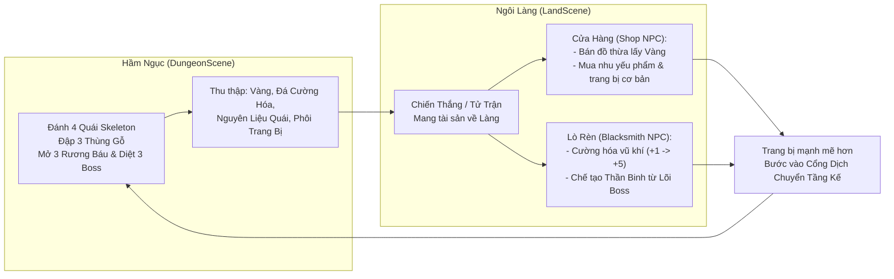

# Bản Thiết Kế Hệ Thống Vật Phẩm (Item & Economy System) - Infinite Labyrinth

> **Dự án:** Infinite Labyrinth (Game 3D Action RPG Roguelite - Đồ Án Tốt Nghiệp)  
> **Phiên bản:** v2.0 - Core RPG Progression System  
> **Tài liệu liên quan:** [SYSTEM_ARCHITECTURE.md](file:///c:/2.tapcodedienloan/!%20Đồ%20án%20tốt%20nghiệp/Infinite%20Labyrinth/Docs/SYSTEM_ARCHITECTURE.md), [ACTIVE_TASKS.md](file:///c:/2.tapcodedienloan/!%20Đồ%20án%20tốt%20nghiệp/Infinite%20Labyrinth/Docs/ACTIVE_TASKS.md)

---

## 1. Triết Lý Thiết Kế Hệ Thống (Design Philosophy)

Hệ thống Item của *Infinite Labyrinth* đóng vai trò là chiếc cầu nối tuần hoàn khép kín giữa **Hành Trình Chinh Phạt Hầm Ngục (`DungeonScene`)** và **Sự Phát Triển Vững Chắc Tại Ngôi Làng (`LandScene`)**:

---

## 2. Bảng Danh Mục 20 Vũ Khí (20 Weapons Catalog)

Toàn bộ 20 vũ khí đều sở hữu model 3D cầm tay trực quan, gắn vào `WeaponSocket` của Player và tự động nhận Hitbox, Slash Trail và Hitlag chuẩn Souls-like:

### Nhóm 1: Kiếm Khởi Đầu & Cơ Bản (Tier 1 - Common & Uncommon)
| STT | ID Vật Phẩm | Tên Hiển Thị (Display Name) | Phẩm Cấp | Model Asset | Nguồn Gốc (Source) | Chỉ Số Cơ Bản (+0) | Cốt Truyện / Đặc Tính |
| :---: | :--- | :--- | :---: | :--- | :--- | :---: | :--- |
| **01** | `weapon_sword_wooden` | **Apprentice Wooden Sword** *(Kiếm Gỗ Tập Sự)* | Common | `WoodenSword.prefab` | **Khởi đầu game (Free)** | ATK: +6 | Kiếm gỗ luyện tập được phát cho mọi tân binh trước khi bước qua cánh cổng ma thuật. |
| **02** | `weapon_sword_rusty_iron` | **Rusty Iron Blade** *(Thiết Kiếm Rỉ Sét)* | Common | `RustyIronSword.prefab` | Mua Shop Làng (50 Vàng) / Thùng gỗ | ATK: +9 | Thanh đoản kiếm sắt đã hoen rỉ do bị bỏ lại nhiều năm trong hầm ngục ẩm ướt. |
| **03** | `weapon_sword_novice` | **Novice Knight Sword** *(Tân Binh Đoản Kiếm)* | Uncommon | `NoviceSword.prefab` | Mua Shop Làng (110 Vàng) / Rương Thường | ATK: +14 | Kiếm chuẩn hiệp sĩ xứ Haven, chuôi bọc da chắc chắn, lưỡi kiếm sáng bóng. |
| **04** | `weapon_sword_broad_iron` | **Broad Iron Blade** *(Thiết Kiếm Bản Rộng)* | Uncommon | `IronBoardSword.prefab` | Mua Shop Làng (175 Vàng) / Rương Thường | ATK: +18 | Thiết kiếm lưỡi dày bản to, nhát chém đầm tay và tạo lực đẩy lùi nhẹ. |
| **05** | `weapon_sword_darkiron` | **Dark Iron Sword** *(Hắc Thiết Kiếm)* | Uncommon | `DarkIronSword.prefab` | Mua Shop (240 Vàng) / Rèn từ Quặng | ATK: +22 | Đúc từ quặng sắt đen khai thác ở tầng ngầm, độ cứng vượt trội so với sắt thường. |

---

### Nhóm 2: Kiếm Phiêu Lưu & Tinh Nhuệ (Tier 2 - Rare)
| STT | ID Vật Phẩm | Tên Hiển Thị (Display Name) | Phẩm Cấp | Model Asset | Nguồn Gốc (Source) | Chỉ Số Cơ Bản (+0) | Cốt Truyện / Đặc Tính |
| :---: | :--- | :--- | :---: | :--- | :--- | :---: | :--- |
| **06** | `weapon_sword_vanguard` | **Vanguard Broadsword** *(Tiên Phong Đại Kiếm)* | Rare | `VanguardSword.prefab` | Rèn Lò Rèn / Rương Hiếm | ATK: +27, Max HP: +20 | Vũ khí của đội quân tiên phong, ban phát thêm sinh mệnh cho người cầm lái. |
| **07** | `weapon_sword_punk` | **Barbed Punk Blade** *(Gai Thép Cuồng Đao)* | Rare | `PunkSword.prefab` | Mua Shop (380 Vàng) / Rương Hiếm | ATK: +31, Stamina: +10 | Thanh kiếm hầm hố với sống kiếm gắn gai sắc nhọn, tối ưu tốc độ chém lướt. |
| **08** | `weapon_sword_bone` | **Bonecleaver Blade** *(Cốt Ma Đoản Đao)* | Rare | `BoneSword.prefab` | **Rèn Lò Rèn** (Cần Xương Skeleton) / Rương Hiếm | ATK: +34, **+40% Poise Damage** | Đẽo gọt từ xương quái Skeleton tinh nhuệ, khiến quái vật cực kỳ nhanh bị vỡ thế (Stagger). |
| **09** | `weapon_sword_equilibrium` | **Equilibrium Blade** *(Kiếm Âm Dương / Cân Bằng)* | Rare | `EquilibriumSword.prefab` | Rương Hiếm phòng ngách cụt | ATK: +37, Max HP: +25 | Lưỡi kiếm nửa sáng nửa tối, cân bằng hoàn hảo giữa sức tấn công và phòng thủ. |
| **10** | `weapon_sword_dead` | **Deathbringer Sword** *(Tử Thần Kiếm)* | Rare | `DeadSword.prefab` | Rơi từ Rương Hiếm Tầng 1 & 2 | ATK: +40, **Hồi +5 HP khi diệt địch** | Thanh kiếm thấm nhuần tử khí, hút lấy sinh lực tàn dư của kẻ thù vừa ngã xuống. |

---

### Nhóm 3: Kiếm Ma Pháp & Tinh Hoa (Tier 3 - Epic)
| STT | ID Vật Phẩm | Tên Hiển Thị (Display Name) | Phẩm Cấp | Model Asset | Nguồn Gốc (Source) | Chỉ Số Cơ Bản (+0) | Cốt Truyện / Đặc Tính |
| :---: | :--- | :--- | :---: | :--- | :--- | :---: | :--- |
| **11** | `weapon_sword_emerald` | **Emerald Jade Edge** *(Bích Ngọc Kiếm)* | Epic | `EmeraldSword.prefab` | Mua Thương Nhân Bí Ẩn / Rương Hiếm Tầng 2 | ATK: +45, DEF: +6 | Chế tác từ khối ngọc bích nguyên khối ngàn năm, tỏa ánh sáng xanh bảo hộ chủ nhân. |
| **12** | `weapon_sword_rose` | **Crimson Rose Rapier** *(Huyết Hồng Kiếm)* | Epic | `RoseSword.prefab` | Rèn Lò Rèn / Rương Boss Tầng 1 | ATK: +49, Stamina: +20 | Lưỡi kiếm đỏ thắm hình dáng nụ hồng gai góc, ra đòn chớp nhoáng tiêu hao ít thể lực. |
| **13** | `weapon_sword_katsunesi` | **Kitsune Spirit Katana** *(Hồ Ly Ma Kiếm)* | Epic | `KatsunesiSword.prefab` | **Rèn Lò Rèn** (Cần Tinh Hoa Ma Pháp Mage) | ATK: +53, **Tăng 30% Sát thương Chiêu E & Q** | Thanh kiếm Katana mang linh hồn cửu vĩ hồ, cường hóa mạnh mẽ kiếm khí và phép nổ. |
| **14** | `weapon_sword_titan` | **Titan Heavy Cleaver** *(Titan Trọng Đại Kiếm)* | Epic | `TitanSword.prefab` | Rương Boss Ice Golem / Rèn | ATK: +58, Max HP: +45 | Đại kiếm đồ sộ chỉ những chiến binh sở hữu sức mạnh phi thường mới có thể vung nhát chém. |
| **15** | `weapon_sword_demonic` | **Nether Demonic Blade** *(Minh Phủ Hắc Kiếm)* | Epic | `DemonicSword.prefab` | **Rương Boss Ice Golem (Tầng 1)** | ATK: +63, Max HP: +30 | Rèn từ hắc kim loại dưới đáy địa ngục, tỏa ra luồng sát khí đen ngòm đáng sợ. |
| **16** | `weapon_sword_ice` | **Frostfang Glacial Sword** *(Băng Nha Cực Kiếm)* | Epic | `IceSword.prefab` | **Rèn Lò Rèn** (Cần Lõi Băng Ice Golem) | ATK: +68, **Hiệu ứng làm chậm tốc độ quái** | Lưỡi kiếm băng tinh giá lạnh không bao giờ tan chảy, làm tê cóng cơ bắp kẻ dính đòn. |

---

### Nhóm 4: Thần Binh Tối Thượng (Tier 4 - Legendary)
| STT | ID Vật Phẩm | Tên Hiển Thị (Display Name) | Phẩm Cấp | Model Asset | Nguồn Gốc (Source) | Chỉ Số Cơ Bản (+0) | Cốt Truyện / Đặc Tính |
| :---: | :--- | :--- | :---: | :--- | :--- | :---: | :--- |
| **17** | `weapon_sword_sunblade` | **Radiant Sunblade** *(Thái Dương Thánh Kiếm)* | Legendary | `RadiantSword.prefab` | Rương Boss Red Ignis / Mở khóa Day 10 | ATK: +75, Stamina: +30 | Thanh hoàng kim kiếm mang ánh sáng mặt trời rực rỡ, xua tan bóng tối hầm ngục. |
| **18** | `weapon_sword_excalibur` | **Excalibur Sovereign** *(Vương Quyền Thánh Kiếm)* | Legendary | `ExcaliburSword.prefab` | Rương Boss Purple Ignis (Tầng 3) | ATK: +84, DEF: +12, Max HP: +60 | Thánh kiếm của các bậc đế vương cổ đại, sở hữu uy lực điều khiển cả vận mệnh. |
| **19** | `weapon_sword_artifact` | **Ancient Artifact Blade** *(Cổ Kiếm Thất Truyền)* | Legendary | `ArtifactSword.prefab` | Rương Hiếm Tầng Sâu / Đền Thờ Cổ | ATK: +92, Max HP: +70, Stamina: +35 | Cổ vật bí ẩn được khai quật từ kỷ nguyên trước, mang sức mạnh vượt ngoài hiểu biết. |
| **20** | `weapon_sword_dragonic` | **Dragonfire Apocalypse** *(Hỏa Long Diệt Thế Kiếm)* | Legendary | `DragonicSword.prefab` | **Tuyệt phẩm Rèn Lò Rèn** (Cần Lõi Lửa Ignis) | ATK: +105, **Hiệu ứng Thiêu Đốt DOT (Burn)** | Thanh kiếm tối thượng của trò chơi, mang linh hồn Hỏa Long đốt cháy mọi sinh linh cản bước. |

---

## 3. Hệ Thống Giáp Bảo Hộ (8 Armors)

Giáp là thẻ thuộc tính mang Icon và chỉ số phòng hộ toàn diện (không cần 3D model để tối ưu hiệu năng và độ ổn định nhân vật):

| STT | ID Vật Phẩm | Tên Giáp (Armor Name) | Phẩm Cấp | Nguồn Gốc | Chỉ Số Buff (Stats) |
| :---: | :--- | :--- | :---: | :--- | :--- |
| **1** | `armor_cloth_novice` | **Novice Cloth Tunic** *(Áo Vải Tân Binh)* | Common | Mua Shop Làng (25 Vàng) / Rương Thường / Thùng gỗ | DEF: +2, Max HP: +10 |
| **2** | `armor_leather_scout` | **Scout Leather Armor** *(Giáp Da Trinh Sát)* | Common | Mua Shop Làng (80 Vàng) / Thùng gỗ | DEF: +5, Max HP: +25, Stamina: +10 |
| **3** | `armor_leather_explorer` | **Explorer Leather Vest** *(Giáp Da Thám Hiểm)* | Uncommon | Mua Shop Làng (160 Vàng) / Rương Thường | DEF: +9, Max HP: +45, Stamina: +15 |
| **4** | `armor_iron_cuirass` | **Reinforced Iron Cuirass** *(Thiết Giáp Cường Hóa)* | Uncommon | Mua Shop (280 Vàng) / Rương Thường | DEF: +15, Max HP: +70 |
| **5** | `armor_bone_carapace` | **Bone Carapace Plate** *(Giáp Xương Quái Hiệp Sĩ)* | Rare | **Chế tạo Lò Rèn** (Xương Skeleton + Vàng) | DEF: +22, Max HP: +110, Stamina: +20 |
| **6** | `armor_frost_guardian` | **Frostborne Platemail** *(Băng Giáp Cực Bắc)* | Epic | **Chế tạo Lò Rèn** (Lõi Băng Boss Golem) | DEF: +32, Max HP: +170, Kháng làm chậm |
| **7** | `armor_crimson_scale` | **Crimson Dragon Scale** *(Hỏa Long Chiến Giáp)* | Legendary | **Chế tạo Lò Rèn** (Lõi Lửa Boss Ignis) | DEF: +45, Max HP: +240, Stamina: +30 |
| **8** | `armor_void_shroud` | **Voidwalker Mantle** *(Hư Không Thần Giáp)* | Legendary | **Rương Boss Purple Ignis** (Tầng 3) | DEF: +58, Max HP: +320, Hồi phục Stamina +25% |

---

## 4. Hệ Thống Nguyên Liệu Rèn & Cường Hóa (Materials)

| Nhóm | ID Vật Phẩm | Tên Nguyên Liệu | Phẩm Cấp | Max Stack | Nguồn Rơi (Source) | Ứng Dụng Chính |
| :--- | :--- | :--- | :---: | :---: | :--- | :--- |
| **Nâng Cấp** | `mat_upgrade_stone` | **Đá Cường Hóa (Enhance Stone)** | Rare | 99 | Rương, Thùng gỗ lớn, Quái tinh nhuệ | Cường hóa mọi vũ khí từ `+1` đến `+5` tại Lò rèn. |
| **Nâng Cấp** | `mat_upgrade_crystal` | **Tinh Thể Hoàn Mỹ (Flawless Crystal)** | Epic | 99 | Rương Boss, Rương Hiếm tầng 2+ | Đột phá vũ khí lên cấp tối thượng (`+4`, `+5`). |
| **Quái Thường** | `mat_bone_fragment` | **Mảnh Xương Quái (Bone Fragment)** | Common | 99 | Skeleton Minion, Skeleton Warrior | Nguyên liệu rèn *Bone Sword* và *Bone Armor*. |
| **Quái Thường** | `mat_warrior_insignia` | **Huy Hiệu Chiến Binh (Warrior Crest)** | Uncommon | 99 | Skeleton Warrior | Rèn giáp sắt và đổi Vàng giá cao tại Shop. |
| **Quái Thường** | `mat_dark_arrowhead` | **Mũi Tên Đen (Dark Arrowhead)** | Uncommon | 99 | Skeleton Rogue | Chế tạo vũ khí cơ động hoặc bán Shop. |
| **Quái Thường** | `mat_arcane_dust` | **Bụi Tinh Hoa Ma Pháp (Arcane Dust)** | Rare | 99 | Skeleton Mage | Chế tạo kiếm phép *Kitsune Katana*. |
| **Quái Thường** | `mat_spell_parchment` | **Giấy Da Cổ Ma Thuật (Ancient Scroll)** | Epic | 20 | Skeleton Mage (Tỉ lệ hiếm 8%) | Nguyên liệu phụ trợ rèn trang bị Epic. |
| **Boss Ice Golem** | `mat_boss_ice_rune` | **Mảnh Cổ Tự Băng (Glacial Rune)** | Epic | 20 | **Rương Boss Ice Golem** (Rơi 2-3 mảnh) | Rèn *Titan Heavy Cleaver* và nâng cấp Băng. |
| **Boss Ice Golem** | `mat_boss_ice_core` | **Trái Tim Băng Giá (Eternal Frost Core)** | Legendary | 10 | **Rương Boss Ice Golem** (Rơi 100% 1 lõi) | Chế tạo *Frostfang Glacial Sword* & *Băng Giáp*. |
| **Boss Red Ignis** | `mat_boss_fire_crest` | **Huy Hiệu Liệt Hỏa (Blazing Crest)** | Epic | 20 | **Rương Boss Red Ignis** (Rơi 2-3 huy hiệu) | Rèn giáp lửa và nâng cấp thuộc tính Hỏa. |
| **Boss Red Ignis** | `mat_boss_fire_core` | **Lõi Lửa Nguyên Thủy (True Flame Core)** | Legendary | 10 | **Rương Boss Red Ignis** (Rơi 100% 1 lõi) | Chế tạo *Dragonfire Apocalypse* & *Giáp Hỏa Long*. |
| **Boss Purple Ignis**| `mat_boss_void_essence`| **Tinh Chất Vực Thẳm (Abyssal Essence)** | Epic | 20 | **Rương Boss Purple Ignis** | Chế tạo trang bị bóng tối và tẩy điểm miễn phí. |
| **Boss Purple Ignis**| `mat_boss_void_eye` | **Con Mắt Hư Không (Void Singularity)** | Legendary | 10 | **Rương Boss Purple Ignis** (Rơi 100% 1 lõi) | Chế tạo *Excalibur Sovereign* & *Hư Không Giáp*. |

---

## 5. Vật Phẩm Tiêu Hao Sinh Tồn (Consumables)

| ID Vật Phẩm | Tên Tiêu Hao | Phẩm Cấp | Max Stack | Giá Bán Shop | Hiệu Quả Tức Thời |
| :--- | :--- | :---: | :---: | :---: | :--- |
| `potion_health_small` | **Bình Máu Nhỏ (Small Health Potion)** | Common | 10 | 25 Vàng | Hồi phục tức thì **40 HP**. |
| `potion_health_large` | **Bình Máu Lớn (Large Health Potion)** | Rare | 5 | 65 Vàng | Hồi phục tức thì **100 HP**. |
| `potion_stamina_elixir`| **Tiên Dược Thể Lực (Stamina Elixir)** | Uncommon | 5 | 45 Vàng | Hồi đầy 100% Thể lực & tăng 50% tốc độ hồi trong 8s. |
| `potion_spirit_nectar` | **Mật Năng Lượng (Spirit Nectar)** | Rare | 3 | 90 Vàng | Tức thì nạp đầy **2 Ngôi Sao Năng Lượng** (100 Spirit). |
| `potion_ironbark_brew` | **Thuốc Da Sắt (Ironbark Brew)** | Uncommon | 5 | 50 Vàng | Tăng **+15 DEF** trong thời gian 30 giây. |
| `potion_berserker` | **Rượu Cuồng Nộ (Berserker Draught)** | Rare | 3 | 85 Vàng | Tăng **+25% ATK** trong 20s (giảm nhẹ 10% DEF). |

---

## 6. Ma Trận Phân Bổ Rơi Đồ (Detailed Drop Tables)

### A. 3 Loại Thùng Gỗ Đập Được (`BreakableProp.cs`):
* **Thùng Nhỏ (`Breakable_Barrel_Small`):**
  * 70%: Rơi 2 – 6 Tiền Vàng.
  * 25%: Rơi 1 Bình Máu Nhỏ.
  * 5%: Rỗng.
* **Thùng Vừa (`Breakable_Barrel_Medium`):**
  * 85%: Rơi 8 – 18 Tiền Vàng.
  * 35%: Rơi 1 Bình Máu Nhỏ hoặc 1 Tiên Dược Thể Lực.
  * 15%: Rơi 1 Đá Cường Hóa.
* **Thùng Lớn (`Breakable_Barrel_Large`):**
  * 100%: Rơi 18 – 35 Tiền Vàng.
  * 40%: Rơi 1 Bình Máu Lớn.
  * 25%: Rơi 1 – 2 Đá Cường Hóa.
  * 5%: Rơi Thiết Kiếm Rỉ Sét (`weapon_sword_rusty_iron`).

---

### B. 4 Quái Vật Skeleton (`EnemyAIBase.cs`):
* **Skeleton Minion (Lính Xương Đánh Lén):**
  * 100%: 3 – 8 Tiền Vàng.
  * 30%: 1 Mảnh Xương Quái (`mat_bone_fragment`).
* **Skeleton Warrior (Chiến Binh Xương Cận Chiến):**
  * 100%: 8 – 16 Tiền Vàng.
  * 45%: 1 – 2 Mảnh Xương Quái (`mat_bone_fragment`).
  * 20%: 1 Huy Hiệu Chiến Binh (`mat_warrior_insignia`).
  * 10%: 1 Đá Cường Hóa (`mat_upgrade_stone`).
* **Skeleton Rogue (Thích Khách Cung Thủ Tầm Xa):**
  * 100%: 10 – 20 Tiền Vàng.
  * 40%: 1 – 2 Mũi Tên Đen (`mat_dark_arrowhead`).
  * 20%: 1 Bình Máu Nhỏ (`potion_health_small`).
  * 12%: 1 Tiên Dược Thể Lực (`potion_stamina_elixir`).
* **Skeleton Mage (Pháp Sư Triệu Hồi & Cầu Lửa):**
  * 100%: 16 – 32 Tiền Vàng.
  * 50%: 1 – 2 Bụi Tinh Hoa Ma Pháp (`mat_arcane_dust`).
  * 25%: 1 Đá Cường Hóa (`mat_upgrade_stone`).
  * 8%: 1 Giấy Da Cổ Ma Thuật (`mat_spell_parchment`).

---

### C. 3 Cấp Độ Rương Kho Báu (`ChestInteractable.cs`):
* **Rương Thường (`Interactive_Chest` - Viền Xanh Lá):**
  * 100%: 30 – 75 Tiền Vàng.
  * 100%: 1 – 2 Bình Máu Nhỏ.
  * 40%: 1 Đá Cường Hóa.
  * 25%: Rơi 1 Trang bị Uncommon ngẫu nhiên (*Novice Knight Sword*, *Broad Iron Blade*, *Explorer Leather Vest*).
* **Rương Hiếm (`Interactive_Chest_Rare` - Viền Tím Thần Bí / Phòng Ngách & Gác Lửng):**
  * 100%: 80 – 180 Tiền Vàng.
  * 100%: 2 – 3 Bình Máu Lớn.
  * 100%: 2 – 3 Đá Cường Hóa (`mat_upgrade_stone`).
  * 50%: Rơi 1 Vũ Khí Rare ngẫu nhiên (*Punk Blade*, *Bonecleaver*, *Deathbringer*, *Equilibrium Blade*).
  * 30%: Rơi Giáp Sắt Cường Hóa (*Reinforced Iron Cuirass*).
* **Rương Boss Bục Đá 12m (`Interactive_Chest_Boss` - Viền Hoàng Kim Thánh Đường):**
  * 100%: **180 – 350 Tiền Vàng** (Bung tỏa hình nón cực đẹp).
  * 100%: **1 Lõi Boss Huyền Thoại Tương Ứng** (Ice Core / Flame Core / Void Eye).
  * 100%: 2 – 3 Mảnh Cổ Tự / Tinh chất Epic của Boss tương ứng.
  * 100%: 3 – 5 Đá Cường Hóa & 1 Tinh Thể Hoàn Mỹ (`mat_upgrade_crystal`).
  * 100%: 3 Bình Máu Lớn & 2 Tiên Dược Năng Lượng.
  * 65%: Rơi 1 Trang bị Epic / Legendary cực phẩm (*Demonic Blade*, *Titan Heavy Cleaver*, *Ancient Artifact Blade*...).

---

## 7. Quy Tắc Hoạt Động Của Cửa Hàng & Lò Rèn

### A. Cửa Hàng Làng Haven (`ShopNPC`):
* **Cơ chế Mua (Buy Tab):** 
  * Cung cấp các mặt hàng cơ bản không bao giờ cạn kiệt (Bình Máu Nhỏ: 25 Vàng, Lớn: 65 Vàng, Thuốc Thể Lực: 45 Vàng, Đá Cường Hóa: 60 Vàng).
  * 3 – 4 trang bị cơ bản cho người chơi nâng cấp ban đầu (Novice Sword, Broad Iron Blade, Scout Leather Armor).
* **Cơ chế Bán (Sell Tab):**
  * Cho phép người chơi bán các trang bị cũ hoặc nguyên liệu quái thừa với giá bằng **40% giá trị gốc (`GoldValue`)**, giúp dọn dẹp túi đồ và có thêm kinh phí rèn đồ.

### B. Lò Rèn Thợ Rèn Haven (`BlacksmithNPC`):
* **Chức Năng 1: Cường Hóa Vũ Khí (Upgrade System):**
  * Mọi vũ khí có thể nâng từ `+0` lên tối đa `+5`. Mỗi cấp tăng **+15% Sát thương cơ bản**.
  * Cấp +1: 1 Đá Cường Hóa + 50 Vàng (100% thành công).
  * Cấp +2: 2 Đá Cường Hóa + 100 Vàng.
  * Cấp +3: 3 Đá Cường Hóa + 200 Vàng.
  * Cấp +4: 1 Tinh Thể Hoàn Mỹ + 4 Đá Cường Hóa + 400 Vàng.
  * Cấp +5 (MAX): 2 Tinh Thể Hoàn Mỹ + 6 Đá Cường Hóa + 700 Vàng (Hiệu ứng vũ khí phát sáng rực rỡ).
* **Chức Năng 2: Chế Tạo Thần Binh (Crafting Recipes):**
  * *Bonecleaver Blade:* 8 Mảnh Xương + 2 Huy Hiệu Chiến Binh + 2 Đá Cường Hóa + 150 Vàng.
  * *Kitsune Spirit Katana:* 6 Bụi Ma Pháp + 1 Giấy Da Cổ + 3 Đá Cường Hóa + 350 Vàng.
  * *Frostfang Glacial Sword:* 1 Trái Tim Băng Ice Golem + 3 Mảnh Cổ Tự Băng + 500 Vàng.
  * *Dragonfire Apocalypse:* 1 Lõi Lửa Ignis + 3 Huy Hiệu Liệt Hỏa + 2 Tinh Thể Hoàn Mỹ + 800 Vàng.
