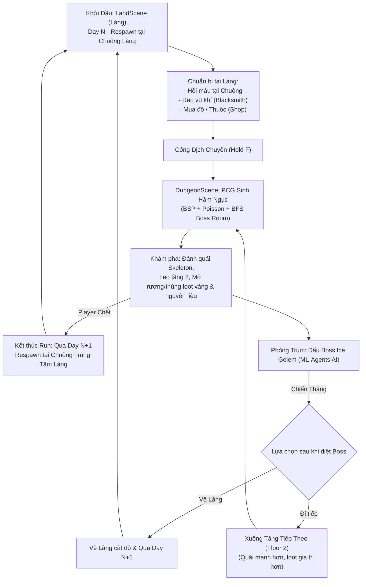
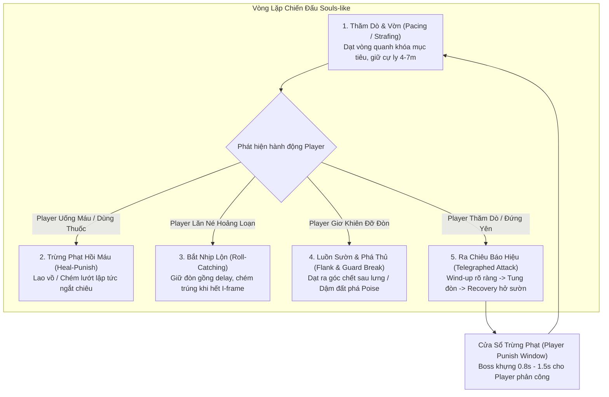

# Kiến Trúc Hệ Thống (System Architecture) - Infinite Labyrinth

> **Dự án:** Infinite Labyrinth (Game 3D Action RPG Roguelite - Đồ Án Tốt Nghiệp)  
> **Phong cách nghệ thuật:** Faceted Low-poly  
> **Engine:** Unity (Universal Render Pipeline - URP)  
> **Ngôn ngữ:** C#  

---

## 1. Vòng Lặp Trò Chơi Cốt Lõi (Core Game Loop & Day System)

---

## 2. Kiến Trúc Các Phân Hệ (System Modules)

### A. Phân Hệ Dungeon PCG (Procedural Content Generation)
Hầm ngục được sinh tự động hoàn toàn mỗi khi người chơi bước qua cổng:
1. **Phân chia không gian (`BSPGenerator.cs`, `BSPNode.cs`):** Thuật toán Binary Space Partitioning chia khối không gian, tạo các phòng và kết nối bằng mạng lưới hành lang. Tích hợp vùng đệm an toàn `startRoomMinGapTiles` ngăn phòng thường sinh quá sát phòng khởi đầu và vùng cấm địa Đại Lộ Boss.
2. **Phân tích hình học & Tìm phòng Boss (`DungeonRoomAnalyzer.cs`):**
   * Sử dụng thuật toán **BFS / Flood-Fill** từ phòng khởi đầu (`startRoom`) để đo độ dài đường đi ngắn nhất.
   * Phòng xa nhất và có không gian đủ lớn sẽ được chọn làm **Boss Room** (`ceilingHeight = 16f`, vòm trần đồ sộ chuẩn đấu trường).
   * Phân loại các phòng chức năng: Start Room, Boss Room, Mezzanine Room (Phòng gác lửng tầng 2), Treasure Room, Normal Room.
3. **Dựng hình học 3D (`DungeonRenderer.cs`):** 
   * Dựng sàn, tường, cửa mở, và hệ thống cầu thang 3D nối sàn tầng 1 lên gác lửng tầng 2.
   * Áp dụng Perlin Noise để tạo độ gồ ghề và biến thể hoa văn vật liệu cho sàn đá.
4. **Trang trí, Templates & Phân bổ đạo cụ (`DungeonPropDecorator.cs` & Sub-modules):**
   * Được thiết kế theo mô hình **Facade Orchestrator & Partial Modules** sạch sẽ:
     * `DungeonPropDecorator.cs`: Nhạc trưởng điều phối, lưu trữ serialized fields và API entry point `DecorateDungeon(...)`.
     * `DungeonPropDecorator.Templates.cs`: 8 mẫu tường vỡ/chữ L/cổng vòm và 5 mẫu tiểu cảnh (trại, tiệc tàn, giả kim, kho đổ nát). Tự động đo Bounding Box, xoay 4 hướng, đảm bảo an toàn cửa/cầu thang.
     * `DungeonPropDecorator.Lighting.cs`: Đuốc sàn (Floor Torch) nâng offset Y 0.5m chống lún chân đế, đuốc tường và đuốc hành lang kiểm tra tường đặc chống lơ lửng.
     * `DungeonPropDecorator.Mezzanine.cs`: Trang trí gác lửng Tầng 2 khớp chuẩn cao độ 8m (cờ hiệu, khiên kiếm, bàn ghế ngắm cảnh lan can và rải rác sàn).
     * `DungeonPropDecorator.Furniture.cs`: Bố trí nội thất áp vách tường, bàn ghế tâm phòng, góc phòng và rải rác tự do.
     * `DungeonPropDecorator.Spatial.cs`: Thuật toán lưới, tính toán `forbiddenTiles` chống đè đồ, kiểm tra tường đặc và phân bố họ cờ hiệu.
     * `DungeonStaticPropCombiner.cs`: Module gộp toàn bộ đồ tĩnh trong mỗi phòng theo Material thành 1 Draw Call duy nhất, tắt Shadow Casting và lọc bỏ MeshCollider thừa cho cờ vải/thủy tinh.
5. **Tối ưu hóa ánh sáng & Hiệu ứng hạt (`DungeonLightOptimizer.cs`):**
   * **Culling kép (Dual Culling):** Bật/tắt đồng bộ cả `Light` (Point Light) và `ParticleSystem` (Lửa & Khói của đuốc) dựa trên cự ly tới Player. Khi ở xa, hạt bị dừng mô phỏng CPU và xóa quads GPU, loại bỏ hoàn toàn hiện tượng Overdraw xuyên tường.
   * **Hysteresis Buffer:** Độ đệm 6m chống nhấp nháy đèn (Flicker-free) ở ranh giới culling.
   * **Triệt tiêu Shadow Caster Pass:** Tự động phát hiện và vô hiệu hóa shadow pass của Directional Light cường độ 0 (tiết kiệm 4 cascades 2048x2048 vô ích).
   * **Duy trì FPS cực cao:** Đạt 110 - 120 FPS ngay cả trong hầm ngục quy mô lớn 300m x 322m với Far Clip Plane 200m.

---

### B. Phân Hệ Combat Souls-like (Player & Monsters)
* **Giao diện Người chơi Souls-like (`PlayerHUD.cs`):**
  * **Thanh Máu (Health Bar):** MainFill đỏ kèm **Ghost Bar** vàng nhạt tụt đuổi từ từ sau thời gian trễ `ghostShrinkDelay = 0.5s` khi dính đòn.
  * **Thanh Thể lực (Stamina Bar):** Màu cam/vàng, co giãn mượt mà khi Lăn né (Roll), Chạy nhanh (Sprint), Chém kiếm (Attack).
  * **Cụm 4 Ngôi Sao Năng Lượng (Spirit Stars):** Nạp đầy dần khi chém trúng quái hoặc parry chuẩn, tiêu hao khi kích hoạt chiêu E (Sóng kiếm - 60), Q (Nổ năng lượng - 90) hoặc R (Tuyệt kỹ Ult - 175).
* **Giao diện Kỹ năng & Cooldown (`SkillIconUI.cs`):**
  * Tự động quản lý 3 ô chiêu thức `SkillE`, `SkillQ`, `SkillR` trong cụm `SkillIconUI`.
  * **Ma trận phản hồi 2 tầng (Dual-State Feedback):**
    * `Corner` (Viền góc): Bật khi đủ Spirit, tắt khi thiếu Spirit để người chơi biết trước đã tích trữ đủ năng lượng hay chưa.
    * `Icon` Alpha: Đạt 1.0 (sáng rực) khi hội tụ đủ 2 điều kiện (Đủ Spirit & Không CD); mờ còn 0.1 khi đang CD hoặc thiếu tài nguyên.
    * `CDFill`: Lớp phủ tối đếm ngược thời gian hồi chiêu ($1.0 \to 0.0$). Tùy chọn hiển thị Text số giây CD.
* **Giao Diện Thanh Máu Quái Vật World Space Souls-like (EnemyHealthBarUI.cs):**
  * **Billboard 3D Thông Minh:** Tự động xoay mặt vuông góc 100% về phía Camera người chơi (CameraAligned), phẳng phiu và không bị méo lệch góc nhìn ở mọi hướng quan sát. Hỗ trợ tùy chọn khóa trục Y (lockYAxis).
  * **Khai Thác Sprite Grayscale & Hiệu Ứng Souls-like:**
    * Sử dụng Monster_Border.png và Monster_Fill.png (chuẩn kích thước 3331x400, tỉ lệ 8.33:1).
    * MainFill: Tô màu đỏ tươi Souls-like từ sprite grayscale qua Image.color.
    * Ghost Bar: Thanh bóng ma màu vàng nhạt tụt đuổi từ từ sau thời gian trễ ghostShrinkDelay = 0.45s khi quái trúng đòn.
  * **Tối Ưu Hóa Hiệu Năng Tuyệt Đối (Dungeon 200 Quái):**
    * Tự động tắt Canvas khi quái ở cự ly xa hoặc ngủ đông (DungeonEnemyOptimizer - 0 Draw Calls).
    * Ẩn thanh máu khi quái đầy 100% HP và chưa vào trạng thái chiến đấu; tự động Fade In mượt mà khi dính đòn hoặc phát hiện người chơi.
    * Tự động Fade Out và tắt hẳn khi quái tử trận (onDeath).
    * Tắt hoàn toàn GraphicRaycaster để loại bỏ 100% chi phí EventSystem Raycasting.
* **Thanh chịu đòn Poise (`PlayerFeedback.cs`, `EnemyFeedback.cs`, `PlayerCombat.cs`, `IceGolemController.cs`):**
  * **Người chơi & Quái thường:**
    * Cả người chơi và quái vật đều sở hữu thanh Poise ẩn (`maxPoise` = 100 cho Warrior/Minion, 50 cho Rogue/Mage).
    * **Cấu hình Sát thương Poise độc lập (`PlayerCombat.cs`):** Mỗi đòn đánh của Player sở hữu lượng sát thương Poise riêng đưa ra Inspector (`attack1PoiseDamage = 25`, `attack2PoiseDamage = 25`, `attack3PoiseDamage = 55`, `chargeHit1PoiseDamage = 35`, `chargeHit2PoiseDamage = 80`, `counterAttackPoiseDamage = 120`).
    * **Super Armor khi còn Poise:** Khi `currentPoise > 0f`, quái vật giữ vững thế đứng chịu đòn, nháy trắng nhận sát thương nhưng KHÔNG bị giật hoạt ảnh `GetHit` và không bị ngắt chiêu (Warrior/Minion đứng vững 2 hit đầu, Rogue/Mage đứng vững 1 hit đầu).
    * **Vỡ thế (Stagger / Poise Break):** Khi Poise tụt về 0 (`currentPoise <= 0f`), quái vật mới bị vỡ thế: ngắt đòn đánh đang thi triển, kích hoạt animation `GetHit`, bị đẩy lùi (knockback), và hồi phục lại `maxPoise`.
    * Tự động hồi phục sau một khoảng trễ không bị đánh (`poiseRecoveryDelay = 2.5s`).
  * **Trùm Ice Golem (Boss Poise = 500):** Sở hữu thanh Poise dày 500 điểm, **không tự hồi phục** trong suốt trận chiến.
    * Sát thương Poise trừ theo độ uy lực và Knockback của từng đòn đánh từ Player:
      + Đòn chém thường 1 & 2 (knockback = 0): trừ 35 Poise.
      + Đòn chém 3 & Charge 1 (knockback > 0): trừ 50 Poise.
      + Đòn chém gồng 2 & Skill E (knockback >= 1.0): trừ 70 Poise.
      + Đòn Counter & Phép nổ Q (knockback >= 1.8): trừ 100 Poise.
    * Khi Poise của Boss về 0: Kích hoạt trạng thái **Suy yếu (WeakenIG)** duy nhất 1 lần (Boss thực hiện động tác bước lùi Weaken hết trọn vẹn clip hoạt ảnh và lập tức tiếp tục chiến đấu ngay tại vị trí mới). Nếu trong lúc đang chạy Weaken mà máu Boss tụt xuống <= 50% HP thì lập tức hủy suy yếu và kích hoạt chuỗi Phase 2 cuồng nộ.
* **Hệ thống Phản hồi Đòn đánh & Khựng Đòn (Hit Feedback & Hitlag - `EnemyFeedback.cs`, `PlayerFeedback.cs`, `WeaponHitbox.cs`, `PlayerCombat.cs`):**
  * **Hiệu ứng Hit VFX Tứa Máu & Mảnh Vụn (Directional Hit VFX):**
    * **Quái xương (Skeleton Monsters):** Khi bị Player chém trúng (combo 1, 2, 3, charge, counter, sóng kiếm E hay nổ Q), `EnemyFeedback` sinh ngay `MobsGetHitVFX.prefab` (màu xám vụn xương) tại điểm tiếp xúc `hitPoint`, góc tứa phun ngược chiều cú chém (`-hitDirection`) ra không khí.
    * **Người chơi (Player):** Khi bị quái chém, bắn tên hoặc phép thuật trúng đích, `PlayerFeedback` sinh ngay `GetHitVFX.prefab` (màu đỏ tứa máu) tại điểm dính đòn `hitPoint`. Khi Player **Parry thành công**, `onCheckParryOrBlock` chặn đứng sát thương trước khi trừ máu nên **không bị tứa máu đỏ**.
    * **Đòn kết liễu (Lethal Hit):** Luôn bảo đảm phát sinh Hit VFX ngay cả khi đòn đánh hạ gục mục tiêu.
    * **Công cụ Tự động hóa 1-Click:** `CombatVfxSetupEditor.cs` với MenuItem `Infinite Labyrinth -> Combat -> 1. Cấu Hình Hit VFX Cho Player & Quái Vật (1-Click)`.
  * **Nháy trắng phát quang (Solid White Flash):** Sử dụng `MaterialPropertyBlock` ghi đè `Texture2D.whiteTexture` và kích hoạt `_EMISSION` (cường độ 2.5) trực tiếp trên GPU (0% clone material, giữ nguyên 100% SRP Batcher).
  * **Đòn kết liễu (Lethal Hit Sequence):** Khi dính đòn tử thủ, quái lập tức nháy trắng toàn thân và giữ màu trắng xuyên suốt thời gian hitlag kết liễu (`lethalFlashDuration = 0.15s` realtime), sau đó trả về màu texture ban đầu rồi mới kích hoạt animation ngã chết (`Die`).
  * **Hitlag Souls-like:** `WeaponHitbox` làm chậm thế giới xuống còn 5% (`Time.timeScale = 0.05f`) trong thời gian unscaled realtime. Toàn bộ giá trị hitlag từng đòn chém (`attack1Hitlag: 0.035s`, `attack2Hitlag: 0.045s`, `attack3Hitlag: 0.08s`, `chargeHit1Hitlag: 0.05s`, `chargeHit2Hitlag: 0.095s`, `counterAttackHitlag: 0.11s`) và đòn kết liễu (`lethalHitlag: 0.18s`) được đưa ra Inspector `PlayerCombat.cs`.
  * **Kiến Trúc Phân Tách Cấp Bậc Nhân Vật (Root Player vs Child MainModel Hierarchy):**
    * **`Player` (GameObject Gốc - Root):** Quản lý toàn bộ vật lý, điều khiển di chuyển, chỉ số tài nguyên và điều phối vệt kiếm slash: `CharacterController`, `PlayerController`, `Health`, `PlayerStats`, `PlayerFeedback`, `TargetLockSystem`, `PlayerSlashVFX`.
    * **`MainModel` (GameObject Con - Child):** Chứa 3D Mesh hình thể, bộ xương cử động, hệ thống tóc đuôi nảy lò xo (`SpringManager`), `Animator` và **`PlayerCombat`**.
    * **Nguyên lý Unity Animation Events:** Các sự kiện chém kiếm, mở/tắt hitbox và kích hoạt vệt slash được cài trực tiếp trên các mốc khung hình của animation clips. Unity chỉ truyền `AnimationEvent` đến các component nằm **trên cùng GameObject với `Animator`**. Do đó, `PlayerCombat` **bắt buộc phải nằm trên `MainModel`**, trong khi các script logic khác nằm ở Root `Player` và được liên kết tham chiếu hai chiều qua `GetComponentInParent` / Serialized fields.
  * **Hiệu ứng Vệt Chém Kiếm & Quỹ Đạo Đòn Đánh (Sword Slash Trail & Arc VFX - `PlayerSlashVFX.cs`, `Slash VFX.prefab`):**
    * **Kiến trúc Decoupled Arc Slash:** Không gắn dính vệt chém vào xương cổ tay hay thân kiếm (tránh hiện tượng xoay tròn méo mó theo cử động xương). VFX chém được điều phối bởi `PlayerSlashVFX.cs`, kích hoạt đúng frame vung kiếm mạnh nhất từ các Animation Events trong `PlayerCombat.cs`.
    * **Cấu hình Độc lập Theo 6 Đòn Đánh:** Mỗi nhát chém sở hữu tham số riêng: Position Offset (cao độ ngang ngực/eo), Rotation Offset (Euler Angles nghiêng chuẩn theo mặt phẳng chém), Scale kích thước, và Lifetime dọn dẹp bộ nhớ:
      + *Attack 1:* Chém vát chéo vai phải xuống hông trái (Rotation: `-176.57°, -92.12°, -92.12°`, Scale 1.0x).
      + *Attack 2:* Chém vát ngược từ hông trái lên vai phải (Rotation: `-85.89°, -183.54°, 0.65°`, Scale 1.05x).
      + *Attack 3:* Chém quét ngang phẳng uy lực kết thúc combo (Rotation: `-176.57°, -92.12°, 0.09°`, Scale 1.25x).
      + *Charge Hit 1:* Chém mở màn lấy đà gồng lực (Rotation: `-176.57°, -92.12°, -45°`, Scale 1.1x).
      + *Charge Hit 2:* Nhát bổ thẳng đứng từ trên cao cắm xuống đất (Rotation: `-90°, -92.12°, -90°`, Scale 1.35x).
      + *Counter Attack:* Cú chém phản đòn bùng nổ năng lượng diện rộng (Rotation: `-176.57°, -92.12°, -15°`, Scale 1.5x).
    * **Cơ Chế Tự Phục Hồi & Tự Động Hóa 1-Click:** `PlayerCombat` tự động tìm kiếm và gắn `PlayerSlashVFX` khi khởi chạy, tự động fallback nạp `Resources/Slash VFX`, `Resources/E Slash VFX`, `Resources/Q Slash VFX` nếu thiếu tham chiếu. Hỗ trợ cấu hình độc lập cho cả 6 đòn đánh cơ bản và 2 kỹ năng đặc biệt (E: Sóng kiếm khí, Q: Đập đất AOE). Hỗ trợ công cụ `PlayerSlashVfxSetupEditor.cs` với MenuItem `Infinite Labyrinth -> Combat -> 2. Cấu Hình Slash, Impact & Parry VFX Cho Kiếm Player (1-Click)` và Custom Editor với đầy đủ 8 nút Test trực quan trong Scene View.
  * **Hiệu ứng Tia Lửa Va Chạm Khi Chém Trúng Đích (Hit Impact Burst VFX - `WeaponHitbox.cs`, `Impact VFX.prefab`):**
    * **Tách rời Impact khỏi Slash Trail (Decoupled Impact):** Tắt Impact gắn cứng trong prefab đường kiếm để tránh nổ chớp sáng vô lý khi chém trượt trong không khí.
    * **Kích hoạt Đúng Điểm Chạm (Contact Point Burst):** `WeaponHitbox.cs` chỉ kích nổ `Impact VFX` khi va chạm với các mục tiêu thuộc Layer `Enemy` (9) hoặc `Damageable` (8) và có thành phần `IDamageable`/`Health`.
    * **Định vị & Hướng Tóe:** Sinh ngay tại `hitPoint = other.ClosestPoint(transform.position)`, góc tứa hướng ngược chiều chém (`-hitDirection`) ra ngoài không khí với độ lệch `hitImpactNormalOffset = 0.05m` chống lẹm mesh. Kích hoạt đồng thời toàn bộ ParticleSystem con (kể cả root có `playOnAwake = false`).
* **Hệ thống Tài nguyên Player (`PlayerStats.cs`):**
  * **Máu (Health):** Gắn liền với `Health.cs` và interface `IDamageable.cs`.
  * **Thể lực (Stamina):** Max 100. Tiêu hao khi Lướt/Lăn né (Roll: 20), Chạy nhanh (Sprint: 15/s), Chém thường (15), Chém gồng (30), Giơ thế đỡ hụt (20). Tự động hồi phục sau 0.85s trễ.
  * **Năng lượng Chiêu thức (Spirit / Focus):** Max 200 (chia 4 sao trên HUD, mỗi sao 50 Spirit). **Không tự hồi**, chỉ tích lũy khi chém trúng quái (+12 thường, +30 gồng, +35 counter, +40 parry chuẩn). Tiêu hao cho kỹ năng:
    * **Phím E:** Sóng kiếm chém xa (`ProjectileSlash.cs`, tốn 50 Spirit - 1 sao).
    * **Phím Q:** Phép nổ năng lượng diện rộng (`AoeSpell.cs`, tốn 100 Spirit - 2 sao).
    * **Phím R:** Tuyệt kỹ Tối thượng Càn quét Khổng lồ (`Skill Ult.anim`, tốn 200 Spirit - 4 sao / Max thanh). Nhân vật tụ lực gồng kiếm (Hyper Armor + Invulnerable), chớp sáng ngang lưỡi kiếm (Sword Gleam Flare), đơ game (Freeze Frame / Hitlag 0.1s), Zoom Punch Camera nén lực, sau đó bung nhát chém ngang phẳng cực đại kèm Slow-motion 0.95s thực tế, vệt kiếm Ultra-wide Slash Trail scale 2.6x và Gigantic Cleave Hitbox quét diện rộng bán kính 5.5m hình quạt 240 độ (hỗ trợ Scene View Gizmos trực quan). Đồng bộ hoàn toàn hệ thống Slow-mo qua `ActiveSlowMoScale` và đa dạng phím tắt [T] / [-] / [=].
* **Cơ chế Đỡ đòn & Phản công (Parry & Counter - `PlayerCombat.cs` & `PlayerFeedback.cs`):**
  * Chuột phải (RMB) kích hoạt thế thủ với cửa sổ vàng `parryWindowDuration = 0.28s`.
  * **Hiệu Ứng Tóe Lửa Va Chạm Lưỡi Kiếm (`Parry VFX.prefab`):**
    * Khi đòn đánh của quái chạm vào Player trong cửa sổ Parry, `Health.onCheckParryOrBlock` kích hoạt `PlayerFeedback.ExecuteParrySuccess`.
    * **Định Vị Điểm Chạm Lưỡi Kiếm:** Không dùng tọa độ va chạm dưới thấp; định vị trực tiếp tại **tâm hình học giữa thân lưỡi kiếm** (`swordTransform.TransformPoint(box.center)` với local center Y = 0.81m) kèm tùy biến bù trừ `parryBladeOffset`, đảm bảo tia lửa luôn nổ đẹp mắt ngay trên thân kiếm ngang tầm mắt/ngực khi giơ thế đỡ.
    * **Phản Hồi Thị Giác & Xung Lực:** Khựng hình Hitlag 0.2s (`parryHitlagDuration`), Camera zoom cận cảnh kịch tính (`TriggerParryZoom`), tia lửa vàng/trắng tóe ngược chiều cú chém của quái, ngắt chiêu đòn đánh và làm choáng kẻ tấn công.
  * Parry trúng đòn: Hoàn trả thể lực, nạp mạnh Spirit (+40), làm choáng đối thủ và mở ra đòn Counter sát thương cực lớn.
* **Cơ chế Né đòn & Di chuyển (`PlayerController.cs`):**
  * Phím Shift: Nhấn nhả (< 0.25s) để Lăn né với 0.45s thời gian bất tử (I-frames); Giữ (> 0.25s) để Sprint.
  * Khóa mục tiêu (Target Lock Souls-like): Camera tập trung vào mục tiêu, nhân vật chuyển sang thế vờn/bước ngang (`strafeSpeed`).
  * Nhảy & Rơi (Jump, Fall, Air Control, phân biệt tiếp đất nhẹ và Hard Landing khựng chân khi rơi từ gác lửng).
* **Đạo diễn Lượt đánh Quái (`AttackTokenDirector.cs`):**
  * Áp dụng hệ thống Token Pool. Quái bao vây chỉ giữ cự ly vờn; chỉ quái nào xin được "Attack Token" từ Director mới được lao vào tấn công, chống spam hội đồng.

---

### C. Phân Hệ Quái Vật (Monsters) & Trùm Học Máy (ML-Agents Boss)
* **Bộ Sinh Quái Tự Động Theo Biệt Đội (`ProceduralEnemySpawner.cs`):**
  * **Cơ chế Cụm / Biệt Đội (Squad / Pack System):**
    * Không bó cứng quái theo tầng mà phối hợp linh hoạt Melee & Ranged theo 4 cấp đội hình:
      * Nhóm 4 quái: 2 Melee (1 Warrior + 1 Minion) + 2 Ranged (1 Rogue + 1 Mage).
      * Nhóm 3 quái: 2 Melee + 1 Ranged HOẶC 1 Melee + 2 Ranged.
      * Nhóm 2 quái: 2 Melee HOẶC 1 Melee + 1 Ranged.
      * Nhóm 1 quái lẻ: Random ngẫu nhiên 1 trong 4 loại quái.
  * **Phân bổ theo quy mô phòng (Dungeon 300x300m):**
    * Sàn trệt phòng thường: 1 – 2 nhóm; Sàn trệt đại sảnh lớn (>= 220 tiles): 2 – 3 nhóm.
    * Sàn tầng 2 gác lửng: 1 – 2 nhóm (tỷ lệ 2 nhóm là 25%).
    * Start Room & Boss Room: Miễn nhiễm hoàn toàn (0 quái).
    * Treasure & Shrine Room: 1 nhóm nhỏ (1–2 quái) canh giữ.
  * **Định vị Cụm (Spatial Clustering):** Mỗi nhóm chọn 1 Điểm Neo (Anchor Point), quái tụ tập bán kính 3m quanh tâm, các nhóm cách nhau tối thiểu 8.5m. Nắn chuẩn 100% lên bề mặt NavMesh và dùng `Physics.CheckSphere` chống kẹt vào đạo cụ tĩnh.
* **Bộ Tối Ưu Hóa Ngủ Đông Quái Vật (`DungeonEnemyOptimizer.cs`):**
  * **Cơ chế 3 Vùng LOD & Ngủ Đông (Hibernation):**
    * *Thức tỉnh hoàn toàn (< 40m):* Quái chạy đầy đủ AI, NavMeshAgent di chuyển và Animator xương.
    * *Vùng đệm Hysteresis (40m - 48m):* Độ đệm 8m chống giật hoặc bật/tắt liên tục khi người chơi đứng sát ngưỡng.
    * *Ngủ đông triệt để (> 48m):* Dừng `NavMeshAgent` (ngắt `ObstacleAvoidanceType.NoObstacleAvoidance`), đặt `Animator.cullingMode = CullCompletely`, ngắt lệnh `Update()` AI -> Giảm 0% chi phí CPU/GPU cho ~200 quái vật ở xa.
  * **Time-Slicing Batching (4 Batches, 0.12s):** Danh sách 200 quái được chia đều thành 4 nhóm để luân phiên tính khoảng cách tới người chơi, triệt tiêu hoàn toàn CPU Frame Spike.
  * **Đánh thức Tức thì (Instant Combat Wakeup):** Khi quái đang ngủ bị người chơi tấn công (bắn tên, phóng chưởng từ xa), hàm `OnTakeDamageAggro` lập tức đánh thức quái dậy phản xạ chiến đấu.
* **Quái thường (Bộ xương Skeleton):**
  1. `SkeletonWarriorAI`: Chiến binh cận chiến, biết leo cầu thang lên/xuống tầng 2 để truy sát người chơi.
  2. `SkeletonMinion`: Quái cận chiến số lượng đông, máu yếu nhưng đánh bọc lót.
  3. `SkeletonRogue`: Thích khách cơ động, bắn cung tầm xa (`Skeleton_Arrow.prefab`), biết giữ khoảng cách.
  4. `SkeletonMage`: Pháp sư bắn đạn ma pháp cầu đuổi (`Light Star.prefab`), thi triển vùng đất bốc cháy (`MageGroundSpell.prefab`) và cột sáng trừng phạt (`LightPillarSkill.prefab`).
* **Bộ Đôi Trùm Hầm Ngục & Cặp Đấu Souls-like (Dual Boss Encounters):**
  1. **Trùm Băng: Ice Golem (`Boss_IceGolem.prefab` - The Frost Juggernaut):**
     * **Chỉ số sinh tồn & Bảng thông số Inspector (`=== BANG THONG SO BOSS (CHINH TRUC TIEP TRONG UNITY INSPECTOR) ===`):**
       * **Máu tối đa (`bossMaxHealth` = 1500 HP):** Máu trùm Souls-like dày dặn, tự động đồng bộ vào component `Health` khi khởi động game và trong Editor.
       * **Thanh chịu đòn Poise (`maxPoise` = 500 điểm):** Độc lập hoàn toàn với sát thương máu, không tự hồi phục trong trận chiến. Bị bào mòn theo độ uy lực và Knockback của từng đòn đánh từ Player (Chém thường: 35, Chém 3 / Charge 1: 50, Chém gồng 2 / Skill E: 70, Counter / Phép Q: 100). Cung cấp event `onPoiseChanged(float current, float max)` và alias `onStaminaChanged` cho UI kết nối.
       * **Cơ chế Suy yếu (`WeakenIG`):** Khi Poise về 0, kích hoạt bước lùi suy yếu duy nhất 1 lần trong trận đấu (`hasTriggeredWeaken = true`). Hoạt ảnh chạy trọn vẹn 100% độ dài clip theo đúng tốc độ người chơi cài đặt (kể cả khi tua chậm `Speed = 0.5`). Tự động chốt tọa độ gốc mới (`CommitWeakenPosition`) để không bị giật lùi về chỗ cũ; không đứng yên bất động sau clip (`weakenFreezeAfterDuration = 0s`), lập tức chuyển về Idle sẵn sàng tiếp tục chiến đấu.
       * **Phase 2 Cuồng Nộ (Enrage Sequence khi HP <= 50% / 750 HP):** Kích hoạt hoạt cảnh chao đảo `50%HP` (4.2s), phát sóng chấn động đẩy lùi Player bán kính 5m (lực đẩy 4.5m) kèm âm thanh và VFX chấn động sàn, gầm thét phun lửa `AttackRoaring`, đợi 3.0s rồi phóng liên tiếp 3 quả cầu tím `IceBallIG` dồn dập. Nhịp độ giao tranh (`combatPacing`) tăng tốc từ 6-7s xuống 4-5s với tần suất tấn công hung hãn.
     * **Bộ chiêu thức hoàn chỉnh (7 Kỹ năng chiến đấu trên `IceGolemController.cs`):**
       * `Attack1` *(Phím 1)*: Đấm thẳng cận chiến kết hợp hiệu ứng va đập Impact VFX (`A VFX Prefabs/Explossion/Impact`).
       * `GumoGumo Slam` *(Phím 2)*: Đấm liên hoàn xuống sàn rung đất 2 tay, tích hợp bộ thông số bắt điểm chạm đất thực tế (`gumoVisualHeightOffset = 0.35m`, `gumoHandContactHeight = 0.55m`, `gumoHandMinHeight = 0.30m`, `gumoHandReleaseHeight = 0.95m`) chống chìm chân vào sàn, bùng nổ hiệu ứng `Attack1 Effect` tại từng vị trí bàn tay tiếp đất.
       * `FlameBreath` *(Phím 3)*: Phun lửa hình nón (Flame Cone) tầm trung 15.5m đa tầng sát thương.
       * `JumpAttack` *(Phím 4)*: Lao bổ / vồ tới mục tiêu từ cự ly xa 20m, phát sinh sóng chấn động tỏa vòng tròn (Radial Shockwave).
       * `RunAttack` *(Phím 5)*: Chạy lao húc thẳng vào Player với vận tốc 12m/s và đẩy văng mạnh mục tiêu; hỗ trợ slot trống `runAuraVfxPrefab` để người dùng tự do kéo thả VFX hào quang xanh quanh thân.
       * `AttackLT_IG` *(Phím 6)*: Chuỗi combo 3 đòn đánh thường liên hoàn cực đẹp; hỗ trợ slot trống `handAuraVfxPrefab` để kéo thả VFX bao quanh 2 bàn tay.
       * `IceBallIG` *(Phím 7)*: Gồng tụ quả cầu ma lực tím `Purple Orb` lơ lửng chính giữa hai bàn tay trên trời (`GetBetweenHandsPosition()`), bám theo tay vươn cao và phình to dần từ 0.4 lên 2.2, sau đó bổ hai tay ném thẳng về phía Player với vận tốc 16m/s và phát nổ diện rộng khi va chạm.
       * `JumpDown` *(Mở màn duy nhất 1 lần khi phát hiện Player / One-Time Intro Cutscene)*: Đáp đất mở màn ấn tượng từ trên cao 12-16m kèm shockwave rền vang lan tỏa từ chân Boss. Tự động kích hoạt khi lần đầu phát hiện Player trong tầm 35m và khóa vĩnh viễn sau cú đáp đất đầu tiên (`hasTriggeredJumpDown = true`), không cho phép dùng đi dùng lại trong trận đấu (đã gỡ bỏ phím Space để tránh spam).
     * **Hệ thống Chiếu sáng Tự Thân & Đạo Diễn Cutscene Intro Bục Đá:**
       * **Hào quang băng giá (`Boss_Aura_Light`):** Tự sinh point light xanh băng rực rỡ (`bodyAuraColor`, range 16m, intensity 3.0) bám theo ngực Boss cao 2.5m, giúp Boss nổi bật ấn tượng trong bóng tối hầm ngục.
       * **Chế độ Standby trên Bục Đá (`SetStandbyOnPedestal`):** Cố định Boss trên bục đá, đóng băng Rigidbody kinematic chờ Cutscene mở màn.
       * **Nhảy từ bục đá & Phun băng chào sân:** Hỗ trợ `PlayIntroJumpDownFromPedestal` (nhảy vòng cung từ bục xuống sàn đấu) và `PlayIntroBreath` (phun lửa nón chào sân).
     * **Hệ thống Di chuyển 4 hướng & Chuẩn Hóa Rig Humanoid:**
       * Chuẩn hóa 100% 14 State trong `BossController.controller` sang Humanoid Sub-asset trong file FBX (`internalID: -203655887218126122`), triệt tiêu hoàn toàn lỗi chìm nửa người xuống đất của các file animation Generic cũ.
       * Nhận diện 4 hướng di chuyển: Tiến (`Walk`), Lùi (`WalkBackIG`), Dạt Trái (`WalkLeftIG`), Dạt Phải (`WalkRightIG`) trong khi vẫn khóa mặt bám sát Player (`strafeMode = true`). Điều khiển thủ công qua **4 phím mũi tên (Arrow Keys)** tách biệt độc lập với phím W, A, S, D của Player.
     * **Khóa mục tiêu & Tự động hóa an toàn:**
       * Tự động phát hiện Player (`autoFindPlayer`), tự xoay mặt đối diện đối thủ (`alwaysFacePlayer`, `facePlayerOnAttack`, tốc độ `facePlayerSpeed = 240 deg/s`).
       * Cơ chế tự bảo vệ chống duplicate component trong `Awake()` và Menu dọn dẹp Scene Editor (`Infinite Labyrinth -> Boss -> 3. Dọn Dẹp Scene & Khắc Phục Lỗi Ice Golem`).
     * **Đạo Diễn Điện Ảnh Chiến Thắng, Biểu Ngữ "VICTORY ACHIEVED" & Bục Đá 12m (`BossVictoryDirector.cs` - Task D02-5B & D02-5C):**
       * Lắng nghe sự kiện `IceGolemController.OnBossDefeated` khi Boss cạn máu (hoặc phím K trong Play Mode).
       * Khựng hình Hitlag 0.22s (`Time.timeScale = 0.05f`) tôn vinh nhát chém kết liễu, tạm khóa điều khiển Player.
       * Camera Cinematic trượt mượt mà tới góc 3/4 mạn phải (cự ly 7.0m, cao 3.5m) ngắm Boss phát hoạt ảnh ngã gục `Dead` xuống sàn đấu trường kèm camera drift chậm.
       * Biểu ngữ hoàng kim Souls-like `BossVictoryBanner` trong `EnemyCanvas` bừng sáng giữa màn hình (Fade In, Breathing Scale, giữ sáng 2.2s rồi Fade Out).
       * **Đạo diễn Bục Đá 12m & Sinh Thưởng (Task D02-5C):** Ngay sau khi banner tắt, camera lia mượt mà lên đỉnh Bục Đá cao 12m (`BossArena_Pedestal`) ở vách Bắc; đồng loạt sinh Rương Boss (`Interactive_Chest_Boss`) và Cổng Dịch Chuyển (`VictoryPortal`) tại các socket `[BossChest_Socket]` và `[Portal_Socket]`; kích nổ cột sáng thần thánh (Point Light range 24m) và giữ camera ngắm bục 2.2s trước khi trượt êm ái quay về sau lưng Player và mở lại toàn bộ điều khiển.
       * **Vô hiệu hóa Reset Episode ML-Agents:** Khóa cờ `respawnBossOnDeath = false` trên `IceGolemAgent.cs` và `Boss_IceGolem.prefab`, bảo đảm Boss nằm gục vĩnh viễn trên sàn khi tử trận và không vô tình reset episode khiến Boss quay lại bục hay Player bị dịch chuyển về phòng khởi đầu.

  2. **Trùm Lửa: Red Ignis (`Boss_RedIgnis.prefab` - The Crimson Duelist / True Flame Ignis):**
     * **Định vị chiến đấu:** Kiếm sĩ tốc độ cao, phản xạ chớp nhoáng (`facePlayerSpeed = 280 deg/s`), áp sát và vờn đối thủ ở cự ly trung bình (4-6m), sở hữu thanh kiếm ma thuật rực lửa.
     * **Chỉ số sinh tồn & Bảng thông số Inspector (`RedIgnisController.cs`):**
       * **Máu tối đa (`bossMaxHealth` = 1200 HP):** Máu độc lập cho mỗi Phase (Phase 1: 1200 HP, Phase 2: Hồi sinh đầy 100% = 1200 HP).
       * **Thanh chịu đòn Poise (`maxPoise` = 400 điểm):** Độc lập với sát thương máu, không tự hồi phục trong trận đấu. Bị bào mòn bởi đòn đánh Player (Chém thường: 25-35, Chém 3 / Charge 1: 50, Charge 2 / Skill E: 70, Counter / Skill Q: 100).
       * **Cơ chế Suy yếu (Poise Break / Weaken):** Khi Poise về 0, kích hoạt trạng thái choáng vỡ thế (`Weaken`) khựng lại 2.2s mở ra cửa sổ cho Player phản công dồn sát thương.
       * **Vận tốc di chuyển:** Tốc độ bước thường `moveSpeed = 4.2m/s` (Phase 1) ➔ `5.5m/s` (Phase 2, tăng +30%); Tốc độ dạt ngang `strafeSpeed = 3.2m/s`.
     * **Cơ Chế 2 Pha Đột Biến (Two-Phase Boss - Rebirth on Death with New Appearance):**
       * **Phase 1 (The Crimson Duelist):** Thanh kiếm đơn, dáng đứng thanh thoát, di chuyển vờn (strafing) ở cự ly 4-6m, chém nhanh, lướt sườn bọc lót.
       * **Thời Khắc Chuyển Pha (Phase Transition on Death):** Khi thanh máu Phase 1 tụt về 0, Boss **không chết ngay** mà kích hoạt chuỗi Tái Sinh (Resurrection):
         - Quỵ gối rơi vào trạng thái bất tử tạm thời (`invulnerable = true`).
         - Bùng nổ vụ nổ sóng nhiệt (Heat Wave Explosion) đẩy lùi Player ra xa.
         - **LỘT XÁC DIỆN MẠO MỚI (New Appearance Transformation):** Hoán đổi Mesh/Model hoặc kích hoạt hào quang lửa rực cháy (Flaming Wings / Dark Flame Aura), vũ khí bao phủ bởi ngọn lửa cuồng nộ (Blazing Blade), phục hồi 100% thanh máu với danh xưng mới.
       * **Phase 2 (True Flame Ignis - The Awakened):** Tốc độ di chuyển tăng 30%, nhịp vung kiếm dồn dập, mở khóa 2 chiêu thức tối thượng (Lướt chém để lại vệt lửa rực cháy mặt sàn và Bão lửa cuồng nộ AOE).
     * **Bộ Chiêu Thức Hoàn Chỉnh (6 Kỹ Năng Chiến Đấu trên `RedIgnisController.cs`):**
       * `Skill 1: Slash Attack` *(Phím 1)*: Đòn chém lướt ngang ngực chớp nhoáng (cooldown 1.5s, damage 22, poise 30), kết hợp VFX vệt lửa kiếm `Assets/VFX/C Sword Slash/Slash Fire VFX.prefab` và `CFXR4 Sword Hit FIRE (Cross).prefab`.
       * `Skill 2: Triple Slash Combo` *(Phím 2)*: Chuỗi 3 nhát chém biến ảo tăng dần tốc độ và sát thương (cooldown 4.5s, damage 18 + 20 + 32, poise 80), kết hợp VFX `CFXR4 Sword Trail FIRE (360 Spiral).prefab`.
       * `Skill 3: Flame Thrust / Dash Slash` *(Phím 3)*: Lướt nhanh 8m xuyên qua sườn đối thủ (cooldown 6.0s, damage 30, knockback 3.5m) — kỹ năng chủ lực trừng phạt Player khi lùi xa uống máu (*Heal-Punish*).
       * `Skill 4: Fire Wave` *(Phím 4)*: Vung kiếm phóng lưỡi sóng lửa kiếm bay xa 16m (cooldown 7.0s, damage 35, tốc độ bay 14m/s, nổ va chạm `Fire Impact.prefab`), sử dụng `Assets/VFX/C Sword Slash/Projectiles/Slash Projectile VFX Fire.prefab`.
       * `Skill 5: Blazing Trail Dash` *(Phím 5 - Mở khóa Phase 2)*: Boss lướt chém với vận tốc 14m/s để lại vệt lửa rực cháy mặt sàn trong 4.0s (cooldown 8.0s, damage va chạm 35 + damage lửa sàn 8/s), ép Player phải liên tục di chuyển không thể đứng yên.
       * `Skill 6: Flame Burst AOE` *(Phím 6 - Mở khóa Phase 2)*: Boss tụ lực cắm kiếm xuống đất kích nổ bão lửa cuồng nộ bán kính 7.5m (cooldown 11.0s, damage 45, knockback 5.0m, phá 60% Poise của Player), tạo vùng sóng lửa quét sàn uy lực.
     * **Hệ thống Vật lý Áo choàng (`UnityChanSpringBone`):**
       * Quản lý bằng `SpringManager.cs` và `SpringBone.cs` đã được vá mã nguồn triệt tiêu 100% lỗi `NullReferenceException`.
       * Tối ưu hóa chuỗi 12 xương hợp lệ (loại bỏ 4 xương ngọn leaf bones `Bone.013`, `Bone.025`, `Bone.035`, `Bone.037` để triệt tiêu lỗi quẹo 90 độ; dọn sạch 7 ô null trong mảng).
       * Tắt `Enable Angle Limits` và `Collide With Ground` để tà áo buông rủ mềm mại theo trọng lực tự nhiên, tối ưu `stiffnessForce = 50`, `dragForce = 0.4`.
     * **Chuẩn Hóa Khung Xương Humanoid & Animation:**
       * Sửa lỗi gốc tự động map nhầm `Hips -> Armature` trong `RedIgnis.fbx`, trỏ chuẩn xác về `mixamorig:Hips`.
       * Chuẩn hóa hoạt ảnh bước đi `Ignis_Walk.fbx` với `Based Upon = Feet / Center of Mass`, nâng Offset cao độ chống hiện tượng lún đất hoặc co ngắn chiều cao thân thể.
     * **Vũ Khí Kiếm Siu Nhân Đỏ (`KiemSiuNhanDo.fbx`):**
       * Thiết lập Import Settings chuẩn vũ khí tĩnh: `Animation Type: None` (tab Rig), tắt `Import Animation`.
       * Gắn vào tay phải qua điểm neo `RightHand_Socket` trên xương `mixamorig:RightHand`, đồng bộ chuyển động 100% theo mọi cử động bàn tay.
       * **Giải quyết góc lệch xương cổ tay FBX gốc:** Xương `mixamorig:RightHand` trong file FBX gốc mang góc xoay nghỉ `Euler(-1.1°, -45.8°, 2.7°)`. Tool biên tập `IgnisWeaponAligner.cs` tích hợp chuẩn hóa T-Pose bằng `HumanPoseHandler` (đặt 100% muscles = 0), cố định vị trí chuôi kiếm vào lòng bàn tay `Hand_R_Weapon`:
         + `localPosition: (0.175, 0.094, -0.074)`
         + `localRotation: Euler(-0.953, -53.529, 83.786)` (quaternion: `x: -0.306, y: -0.330, z: 0.593, w: 0.667`)
         + `localScale: (0.8, 0.8, 1.0)` (Bảo toàn 100% tỷ lệ kiếm mỹ thuật do người dùng cấu hình).
     * **Kiến Trúc Điều Khiển & Giao Tiếp Học Máy (Brain - Body):**
       * **Body (`RedIgnisController.cs`):** Quản lý 6 chiêu thức, hoạt ảnh, hệ thống hồi chiêu độc lập, thanh máu, Poise, chuỗi Tái Sinh Phase 2, và bộ phím nóng thử nghiệm thủ công (Phím 1..6 và phím Mũi Tên di chuyển 4 hướng).
       * **Brain (`RedIgnisAgent.cs`):** Bộ não học máy kế thừa `Unity.MLAgents.Agent`, giao tiếp với Body qua các hàm công khai `Move(h, v)`, `CastAttack(skillIndex)`, `CanCastAttack(skillIndex)`, `GetCooldownNormalized(skillIndex)`, và cờ trạng thái `isPhase2`.

---

### D. Kiến Trúc AI Souls-like & Học Máy Tăng Cường (Boss ML-Agents Architecture)

#### 1. Triết Lý Thiết Kế Hành Vi Trùm Souls-like (Souls-like Combat Dynamics)
Để tạo ra trải nghiệm giác đấu nghẹt thở chuẩn phong cách Souls-like (*Elden Ring, Dark Souls, Sekiro*), AI không được phép là "bot xả chiêu vô tội vạ" mà phải tuân thủ nghiêm ngặt 5 nguyên lý:

1. **Báo Hiệu Đòn Đánh (Tell & Telegraphing):** Mỗi chiêu thức chia làm 3 pha rõ rệt:
   * *Pha Gồng (Wind-up):* Giơ cao tay / ngửa cổ lấy đà rõ ràng, kèm âm thanh và VFX tụ lực để người chơi kịp phán đoán né hoặc Parry.
   * *Pha Tung Đòn (Active/Release):* Chém chớp nhoáng hoặc dậm sàn uy lực, gây sát thương.
   * *Pha Hồi Chiêu Khựng Đòn (Recovery Window):* Sau khi ra đòn, Boss có 0.8s - 1.5s thở/thu thế (Punish Window) để người chơi giỏi có cơ hội lao vào phản kích trừng phạt.
2. **Nhịp Thở & Vờn Đối Thủ (Pacing & Circling/Strafing):** Boss không cắm đầu chạy thẳng. Boss biết **bước dạt ngang (Strafe Left / Right)** vòng quanh người chơi ở cự ly trung bình, quan sát thể lực và thế thủ của người chơi để tạo áp lực tâm lý như một kẻ săn mồi.
3. **Bắt Nhịp Lộn Hoảng Loạn (Roll-Catching):** Khi Player hoảng loạn bấm Lăn né liên tục (Panic Roll), AI học được cách **giữ đòn trễ nhịp (Delayed Attack / Tracking Swing)** để vung đòn trúng ngay khoảnh khắc Player vừa chạm đất hết thời gian bất tử (I-frames).
4. **Trừng Phạt Khi Dùng Bình Máu (Heal-Punish / Input Reading):** Khi phát hiện Player lùi xa uống máu (`isHealing = true`), Boss lập tức kích hoạt chiêu áp sát nhanh (`JumpAttack` của Golem hoặc Lướt kiếm của Ignis) để trừng phạt sơ hở.
5. **Phân Định Cơ Chế Giai Đoạn (Phase 2 Cuồng Nộ vs Two-Phase Rebirth):**
   * **Ice Golem (Phase 2 Cuồng Nộ - Enrage Sequence tại 50% HP):** Trận đánh chia làm 2 giai đoạn: Giai đoạn 1 (HP > 50%) rình rập, đánh đòn chuẩn nhịp; Giai đoạn 2 (HP <= 50% / 750 HP) bùng nổ chuỗi chuyển pha Cuồng nộ (chao đảo `50%HP`, sóng đẩy lùi người chơi, gầm thét phun lửa `AttackRoaring`, xả 3 cầu tím ma thuật dồn dập, và rút ngắn nhịp thở combat pacing từ 6-7s xuống 4-5s tạo sức ép áp đảo). Đồng thời sở hữu thanh Poise (500 điểm) độc lập gây trạng thái Suy yếu `WeakenIG` 1 lần duy nhất.
   * **Red Ignis (2 Pha - Tái Sinh Khi Chết & Lột Xác Diện Mạo Mới):** Sở hữu cơ chế 2 Pha kinh điển Souls-like (*Malenia, Sister Friede*). Khi thanh máu Phase 1 về 0, Boss quỵ ngã -> bùng nổ ngọn lửa địa ngục đẩy lùi người chơi -> hồi sinh 100% máu và **lột xác sang diện mạo mới** (New Appearance Model / Flaming VFX / Blazing Sword), kích hoạt bộ não AI Phase 2 với nhịp độ áp sát và combo hủy diệt.

---

#### 2. Thiết Kế Mạng Nơ-ron ML-Agents (Reinforcement Learning with PPO)

* **Không Gian Quan Sát (Observation Vector - 29 floats chuẩn hóa trong `IceGolemAgent.cs`):**
  | Nhóm dữ liệu | Số chiều | Ý nghĩa chi tiết |
  | :--- | :---: | :--- |
  | **Vị trí tương đối tới Player** | 2 | Tọa độ phẳng chuẩn hóa tới Player (`toPlayer.x / arenaRadius`, `toPlayer.z / arenaRadius`) |
  | **Khoảng cách tới Player** | 1 | Khoảng cách thực tế chuẩn hóa (`dist / arenaRadius`) |
  | **Góc quay đối diện** | 2 | Góc quay mặt Boss so với hướng Player dạng Cos & Sin liên tục (`cosAngle`, `sinAngle`) |
  | **Sinh mệnh Boss** | 1 | Tỷ lệ máu hiện tại của Boss (`bossHealth / 1500f`) |
  | **Trạng thái bận của Boss** | 1 | Boss đang bận ra đòn / nhảy (`controller.IsBusy() ? 1f : 0f`) |
  | **Thời gian hồi chiêu 7 Kỹ năng** | 7 | Tỷ lệ hồi chiêu của 7 kỹ năng chiến đấu (`GetCooldownNormalized(0..6)`) |
  | **Sinh mệnh Player** | 1 | Tỷ lệ máu hiện tại của Player (`playerHealth.CurrentHealth / playerHealth.MaxHealth`) |
  | **Thể lực Player** | 1 | Tỷ lệ Stamina của Player (`playerStats.CurrentStamina / playerStats.MaxStamina`) |
  | **Trạng thái chiến đấu Player** | 5 | `IsAttacking`, `IsBlockingOrParrying`, `IsRolling` (I-frame), `isPlayerInRollRecovery` (Cơ hội Roll-Catch), `IsGrounded` |
  | **Vận tốc di chuyển Player** | 2 | Vận tốc tương đối dọc và ngang của Player theo góc nhìn Boss (`Mathf.Clamp(vel / 10f, -1f, 1f)`) |
  | **Cảm biến tường đấu trường** | 4 | Raycast khoảng cách tới tường 4 hướng: Trước, Sau, Trái, Phải |
  | **Vị trí Boss so với tâm sàn** | 2 | Tọa độ phẳng của Boss so với tâm đấu trường (`toCenter.x / arenaRadius`, `toCenter.z / arenaRadius`) |

* **Không Gian Hành Động (Action Space - Discrete Branches):**
  * **Branch 0 - Di chuyển & Vờn đối thủ (5 lựa chọn):**
    * `0`: Đứng thủ thế / Thăm dò (Idle)
    * `1`: Tiến thẳng áp sát (Move Forward)
    * `2`: Lùi lại giữ cự ly an toàn (Move Backward)
    * `3`: Dạt trái vòng quanh Player (Strafe Left)
    * `4`: Dạt phải vòng quanh Player (Strafe Right)
  * **Branch 1 - Kỹ năng chiến đấu (8 lựa chọn):**
    * `0`: Không ra chiêu (Chờ thời cơ hoặc giữ nhịp thở)
    * `1`: Đòn đánh thường cận chiến (Attack 1)
    * `2`: Đấm sàn rung đất liên hoàn 2 tay (GumoGumo Slam)
    * `3`: Phun lửa hình nón tầm trung (Flame Breath)
    * `4`: Nhảy vồ áp sát tầm xa 20m kèm shockwave tròn (Jump Attack)
    * `5`: Chạy lao húc thẳng vận tốc 12m/s (Run Attack)
    * `6`: Combo 3 đòn liên hoàn tăng dần sát thương (AttackLT_IG)
    * `7`: Tụ quả cầu ma lực tím ném xa 16m phát nổ (IceBallIG)
  * **Branch 2 - Tùy biến Nhịp đòn (2 lựa chọn):**
    * `0`: Đánh ngay với tốc độ chuẩn (Immediate timing)
    * `1`: Đánh trễ 0.35s để bắt bài roll hoảng loạn (Delayed Attack / Roll-catcher)

* **Thiết Lập Hàm Thưởng / Phạt (Reward Function):**
  | Hành vi | Điểm thưởng/phạt | Mục đích huấn luyện |
  | :--- | :---: | :--- |
  | **Đánh trúng Player (khi không bị né/parry)** | `+1.0 * (damage / 20f)` | Khuyến khích tấn công chính xác |
  | **Trừng phạt thành công khi Player uống máu** | `+2.0` | Tạo phản xạ Heal-Punish kinh điển Souls-like |
  | **Bắt trúng đòn khi Player vừa hết Roll I-frame** | `+1.5` | Huấn luyện kỹ năng Roll-Catching |
  | **Hạ gục Player (Player HP = 0)** | `+5.0` ➔ `EndEpisode()` | Mục tiêu tối thượng của trận đấu |
  | **Duy trì khoảng cách combat lý tưởng (3m - 6m)** | `+0.001` per step | Khuyến khích vờn quanh, không chạy ra góc lag |
  | **Tung chiêu trượt vào không khí** | `-0.3` | Tránh spam chiêu vô tội vạ |
  | **Tung chiêu khi Player đang trong I-frame né đòn** | `-0.5` | Dạy AI không đánh vào lúc đối thủ bất tử |
  | **Bị Player Parry thành công (Bị choáng)** | `-1.5` | Dạy AI biết sợ thế thủ và không ra đòn dễ đoán |
  | **Bị Player chém trúng** | `-0.4 * (damage / 20f)` | Dạy AI biết né tránh, dạt sườn giữ khoảng cách |
  | **Boss tử trận (Boss HP = 0)** | `-5.0` ➔ `EndEpisode()` | Trừng phạt thất bại |
  | **Phạt thời gian tồn tại (`Existence Penalty`)** | `-0.0005` per step | Ép Boss chủ động kết liễu trận, chống cù nhây |

* **Quy Trình Đào Tạo Đa Sàn Đấu (Multi-Arena Parallel Training):**
  * Trong Scene huấn luyện, nhân bản **8 hoặc 16 sàn đấu Arena** chạy song song.
  * Huấn luyện thông qua `mlagents-learn` với thuật toán PPO trên môi trường Python ảo (`venv`), xuất ra file **`.onnx`** (ví dụ `IceGolem_SoulsAI.onnx` và `RedIgnis_SoulsAI.onnx`).
  * Nạp file `.onnx` vào component `Behavior Parameters` (chế độ `Inference Only`) để chạy mượt mà 100% thời gian thực trong game cuối cùng mà người chơi không cần cài Python hay PyTorch.

---

### D. Phân Hệ Tiến Trình RPG (RPG Progression & Economy)
1. **Hệ Thống Rơi Đồ Thế Giới (Loot Drop & World Drops):**
   * **Nguồn rơi đồ:** Quái vật chết (`Health.onDeath`), Thùng gỗ/hòm đập vỡ (`BreakableProp.cs` nhận đòn qua `IDamageable`), Rương kho báu mở (`ChestInteractable.cs`).
   * **Hệ Thống 3 Cấp Độ Rương & VFX Tia Sáng Mở Nắp (Chest Tiers & Opening Light Rays):**
     * **Rương Thường (`Interactive_Chest.prefab`):** Model rương gỗ cổ điển, phát chùm tia sáng xanh lá (`#22C55E`).
     * **Rương Hiếm (`Interactive_Chest_Rare.prefab`):** Model viền vàng nạm ngọc, phát chùm tia sáng tím thần bí (`#A855F7`).
     * **Rương Boss (`Interactive_Chest_Boss.prefab`):** Model rương hoàng kim đại thánh đường (scale 1.35x), phát chùm tia sáng vàng kim rực rỡ (`#F59E0B`).
     * **Cơ chế tia sáng đa tầng (`OpenVFX`):** Gồm `Point Light` (Flash Flare bùng nổ khi hé nắp qua `FlashLightRoutine`), `Rays` (luồng tia sáng nón vươn cao), `Stars` (hạt sao lấp lánh) và `Circles` (vòng hào quang). Tự động kích hoạt đồng bộ khi nắp rương hé mở (`vfxDelay = 0.05s`) qua `ChestInteractable.cs`.
   * **Hiệu ứng vật lý văng đồ (Arc Pop Physics):** Vật phẩm búng nảy theo hình vòng cung parabol nhẹ khi xuất hiện (`LootDropper.cs`), tránh đè dính chùm.
   * **Vật phẩm thế giới (`WorldItemPickup.cs`):** Model 3D thu nhỏ, xoay lơ lửng, tia sáng hào quang nhẹ (Loot Beam/Glow) tương ứng theo độ hiếm.
   * **Tương tác nhặt đồ:** Player lại gần trong bán kính 2m hiển thị Pickup Prompt UI (Icon + Tên + Phím `[F]`). Tiền Vàng hỗ trợ cơ chế tự động bay hút (Magnetic Auto-pickup) khi lại gần.
   * **Thông báo nhặt đồ (`PickupNotificationFeed.cs`):** Xếp chồng mép trái màn hình, trượt mượt lên từ dưới (smooth slide up), mờ dần sau 2.5s.
2. **Hệ Thống Túi Đồ 2 Cửa Sổ (Dual-Pane Inventory Screen - Phím Tab):**
   * **Kiến trúc điều phối chính (`InventoryUIController.cs`):** Quản lý đóng/mở mượt mà bằng CanvasGroup (phím `Tab` hoặc `Esc`), tự động giải phóng con trỏ chuột (`Cursor.lockState = None`), khóa di chuyển người chơi và đóng băng xoay camera / combat. Tự động kiểm tra và khởi tạo `EventSystem` + `InputSystemUIInputModule` tại runtime nếu scene bị thiếu.
   * **Cửa sổ Trái (Character & Stats):**
     * **3D Character Preview (`CharacterPreviewController.cs`):** Camera phụ chuyên dụng soi nhân vật qua `RenderTexture` (512x512). Thiết lập `cullingMask = 1 << 3` (chỉ soi Layer 3: Player) giúp loại bỏ 100% tường, sàn, quái hầm ngục khỏi khung xem trước; kèm đèn định hướng mềm. Hỗ trợ sự kiện chuột `IDragHandler` cho phép nhấp giữ chuột trái và kéo ngang trên khung để xoay nhân vật 360 độ. Tự động tắt Camera khi đóng túi để tiết kiệm 100% tài nguyên GPU trong lúc chơi game.
     * **Ô trang bị (`EquipmentSlotUI.cs`):** Quản lý 2 ô chuyên dụng: Ô Vũ khí (`WeaponSlot`) & Ô Giáp (`ArmorSlot`). Tự động ẩn placeholder khi đã mặc đồ, đổi icon và tô màu nền trắng `RarityBG` theo phẩm cấp món đồ. Click vào mở popup chi tiết với nút `[Tháo ra]`.
     * **Bảng chỉ số thời gian thực (`PlayerStatsPanelUI.cs`):** Tự động liên kết và đọc chỉ số từ `PlayerCombat.cs`, `Health.cs`, `PlayerStats.cs` và `InventoryManager.cs`. Hiển thị: Sát thương tấn công (ATK + Bonus), Phòng thủ (DEF), Máu tối đa (Max HP + Bonus), Thể lực tối đa (Stamina + Bonus). Cập nhật tức thì ngay khi đổi trang bị.
     * **Nút Cộng Điểm Tiềm Năng (`BtnAttributePoints`):** Mở Modal phân bổ thuộc tính (sẵn sàng kết nối Task RPG-05).
   * **Cửa sổ Phải (Kho Đồ & Thao Tác):**
     * **Thanh Tab phân loại 4 danh mục:** `BtnAll` (Tất cả), `BtnWeapon` (Vũ khí), `BtnArmor` (Giáp), `BtnItem` (Vật phẩm tiêu hao & nguyên liệu). Tự động lọc lưới và điều khiển viền góc `SelectHighlight` tương ứng, giữ nguyên độc lập bảng màu `Color Tint` trên Button của Unity.
     * **Lưới 30 ô túi đồ (`InventorySlotUI.cs`):** GridLayoutGroup 5x6. Hiển thị Icon (tự động ẩn an toàn nếu chưa có sprite), nền trắng `RarityBG` đổi màu theo phẩm cấp Rarity, số lượng dồn stack (`xCount`), viền trang trí góc `SelectHighlight` khi được chọn.
     * **Hiển thị Tiền Vàng:** Cập nhật số dư vàng thời gian thực qua event `OnGoldChanged`.
     * **Bảng Chi Tiết Vật Phẩm Động (`ItemDetailPopupUI.cs`):**
       * Tự động tính toán toạ độ và bám theo ô đồ vừa click (`PositionNearSlot`): Mặc định đặt góc trên-trái của Popup nằm đúng tâm ô đồ; nếu ô ở hàng dưới cùng thì tự động đảo pivot thành góc dưới-trái để trồi lên trên; nếu ô ở sát mép phải thì tự động mở sang trái, đảm bảo 100% không tràn khỏi màn hình. Click lại chính ô đó sẽ tự động đóng Popup.
       * Tách riêng Text độ hiếm `ItemRarity` (tô màu theo phẩm cấp) và phân loại `ItemType`.
       * Cụm 4 nút hành động: `BtnEquip` và `BtnUnequip` xếp đè cùng 1 vị trí (Trang bị hiện khi xem đồ trong túi, Tháo ra hiện khi xem đồ đang mặc); `BtnUse` cho vật phẩm tiêu hao (bình máu); `BtnDrop` vứt đồ rơi ra sàn thế giới.
3. **Kinh Nghiệm, Cấp Độ & Điểm Tiềm Năng (`PlayerProgression.cs`, `AttributeAllocationUI.cs`):**
   * **EXP & Cấp độ:** Tiêu diệt quái vật (`EnemyAIBase.cs`) nhận EXP. Cập nhật thanh EXP dạng vòng tròn chữ C (`ExpRingFill`) trên `PlayerHUD.cs` với ánh xạ fill từ `0.19` đến `0.58`. Hiển thị Cấp độ trên huy hiệu `LevelText`.
   * **Điểm tiềm năng (Attribute Points):** Lên cấp thưởng điểm (mặc định 3 điểm / cấp). Mở modal phân bổ từ nút `BtnAttributePoints` ở cửa sổ trái Inventory (hiển thị badge `+X` điểm khả dụng).
   * **Phân bổ 3 chỉ số:** Sức Tấn Công (ATK), Máu Tối Đa (Max HP), Thể Lực Tối Đa (Max Stamina) với chế độ xem trước thay đổi chỉ số thời gian thực (`Current -> Preview (+Bonus)`).
   * **Đồng bộ Combat & Sinh tồn:** Bấm "Xác Nhận" áp dụng trực tiếp vào `Health.cs` (`BaseMaxHealth` + `SetBonusMaxHealth`), `PlayerStats.cs` (`BaseMaxStamina` + `SetBonusMaxStamina`) và `PlayerCombat.cs` (`TotalAttackBonus` cho toàn bộ các đòn đánh).
   * **Tẩy Điểm Tiềm Năng (Reset Stats):** Nút Reset tiêu tốn X Vàng (tùy biến Inspector, mặc định 100 Vàng) qua `InventoryManager.cs`. Hoàn lại 100% điểm tiềm năng và xóa bỏ toàn bộ bonus đã cộng. Kiểm tra chặt chẽ số dư Vàng và khóa nút nếu không đủ.
4. **Hub Ngôi Làng & Thợ Rèn (`LandScene`):**
   * **Chuông Làng Trung Tâm (Village Bell):** Điểm linh hồn hồi phục 100% máu, điểm Respawn sau khi tử trận.
   * **Thợ rèn (Blacksmith):** Tiêu tốn nguyên liệu (Đá cường hóa kiếm) và Vàng để nâng cấp vũ khí (+1, +2...), tăng sát thương chém và hiệu ứng visual.
   * **Cổng dịch chuyển (`PortalController.cs`):** Giữ phím F để bước vào Dungeon thông qua màn hình Loading Screen bất đồng bộ.

---

### E. Phân Hệ Màn Hình Tải Bất Đồng Bộ & Sinh Hầm Ngục Theo Chặng (Asynchronous Loading Screen & Time-Sliced PCG)
* **Bộ Điều Phối Toàn Cục (`LoadingScreenManager.cs` - Singleton & DontDestroyOnLoad):**
  * Tự động khởi tạo và nạp tài nguyên từ `Resources/` (`EnsureInstance()`) mà không phụ thuộc vào thiết lập thủ công trong Scene.
  * **Pha 1 (0% -> 40%):** Tải Scene từ đĩa vào RAM bất đồng bộ qua `SceneManager.LoadSceneAsync(allowSceneActivation = false)` cho đến khi đạt 90% dữ liệu gốc.
  * **Pha 2 (40% -> 100%):** Tự động phát hiện `DungeonManager` và liên kết với Coroutine `GenerateWorldRoutine` sinh PCG theo từng chặng.
  * **Bảo vệ Trải nghiệm & Chống Chớp Nháy (`minLoadingTime = 1.6s`):** Đảm bảo giữ màn hình tối thiểu 1.6 giây để người chơi kịp đọc trọn vẹn mẹo chơi, đồng thời chờ thanh tiến trình dâng đủ 100% trước khi Fade Out mượt mà đưa nhân vật vào thế giới.
* **Giao Diện Màn Hình Tải (`LoadingScreenUI.cs`, `LoadingScreenData.cs`, `LoadingScreenCanvas.prefab`):**
  * **Khung Ảnh Nền Ngẫu Nhiên (RawImage Full-screen):** Nhận ngẫu nhiên 1 trong 13 ảnh render 3D hầm ngục mẫu kết hợp lớp phủ Vignette tối tương phản cao.
  * **Tiêu Đề Địa Danh (Header):** Tiêu đề chính vàng kim (`LocationTitle`) và phụ đề bạc (`LocationSubtitle`) đổi linh hoạt theo ngữ cảnh (ví dụ: *"INFINITE LABYRINTH - FLOOR 1"* hoặc *"HAVEN VILLAGE"*).
  * **Mẹo Sinh Tồn Ngẫu Nhiên (Gameplay Tips):** Hệ thống 21 mẹo tiếng Anh được phân loại theo 5 nhóm: `COMBAT`, `EXPLORATION`, `BOSS TACTICS`, `VILLAGE HUB`, `ROGUELITE`.
  * **Thanh Tiến Trình Souls-like:** Sử dụng cặp sprite `Monster_Border.png` + `Monster_Fill.png`, nạp màu hổ phách vàng rực, nội suy mượt mà qua `Mathf.MoveTowards`.
  * **Phần Trăm & Ấn Ký Spinner:** Hiển thị số `%` ở góc phải thanh loading và ấn ký vòng tròn xoay tròn liên tục theo `Time.unscaledDeltaTime`.
* **Sinh Hầm Ngục Theo Chặng (Time-Sliced PCG - `DungeonManager.cs`, `DungeonRenderer.cs`):**
  * Chia nhỏ việc dựng lưới 3D, gác lửng tầng 2, props và bake NavMesh thành các giai đoạn qua nhiều khung hình (`yield return null`), triệt tiêu 100% hiện tượng khựng đơ khung hình khi tạo lập hầm ngục quy mô lớn.

---

## 3. Quản Lý Trạng Thái Toàn Cục (Game Architecture Patterns)
- **Persist Data:** Sử dụng `GameManager` (DontDestroyOnLoad) hoặc ScriptableObjects để lưu trữ trạng thái giữa các lần chuyển Scene:
  * `CurrentDay`: Số ngày hiện tại (Day 1, Day 2...).
  * `CurrentFloor`: Tầng hầm ngục hiện tại (Floor 1, Floor 2...).
  * `PlayerSaveData`: Lượng Vàng, EXP, Level, Chỉ số nâng cấp, Kho đồ Inventory.
- **Scene Routing:**
  * `LandScene` -> `DungeonScene` (qua Portal).
  * `DungeonScene` (thắng Boss) -> UI popup chọn: Về Làng (`LandScene`) hoặc Đi tiếp (`DungeonScene` tầng kế).
  * `DungeonScene` (thua cuộc) -> Tự động chuyển về `LandScene` tại vị trí Chuông Làng.
