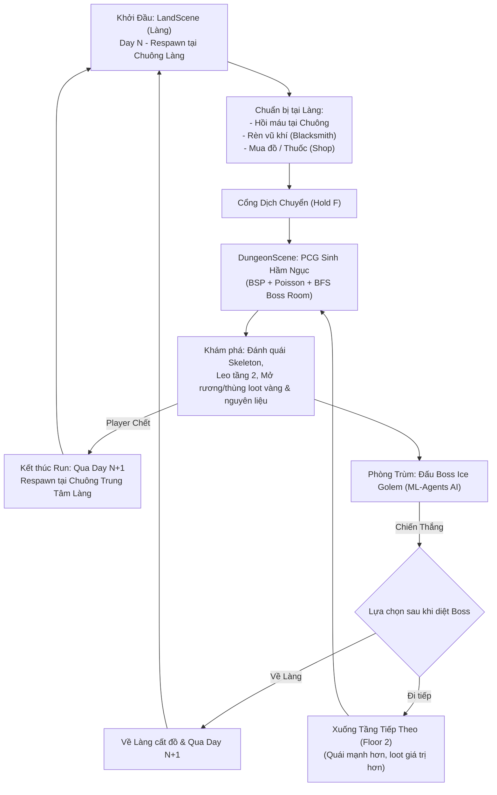

# Kiến Trúc Hệ Thống (System Architecture) - Infinite Labyrinth

> **Dự án:** Infinite Labyrinth (Game 3D Action RPG Roguelite - Đồ Án Tốt Nghiệp)  
> **Phong cách nghệ thuật:** Faceted Low-poly  
> **Engine:** Unity (Universal Render Pipeline - URP)  
> **Ngôn ngữ:** C#  

---

## 1. Vòng Lặp Trò Chơi Cốt Lõi (Core Game Loop & Day System)

---

## 2. Kiến Trúc Các Phân Hệ (System Modules)

### A. Phân Hệ Dungeon PCG (Procedural Content Generation)
Hầm ngục được sinh tự động hoàn toàn mỗi khi người chơi bước qua cổng:
1. **Phân chia không gian (`BSPGenerator.cs`, `BSPNode.cs`):** Thuật toán Binary Space Partitioning chia khối không gian, tạo các phòng và kết nối bằng mạng lưới hành lang.
2. **Phân tích hình học & Tìm phòng Boss (`DungeonRoomAnalyzer.cs`):**
   * Sử dụng thuật toán **BFS / Flood-Fill** từ phòng khởi đầu (`startRoom`) để đo độ dài đường đi ngắn nhất.
   * Phòng xa nhất và có không gian đủ lớn sẽ được chọn làm **Boss Room** (`ceilingHeight = 16f`, vòm trần đồ sộ chuẩn đấu trường).
   * Phân loại các phòng chức năng: Start Room, Boss Room, Mezzanine Room (Phòng gác lửng tầng 2), Treasure Room, Normal Room.
3. **Dựng hình học 3D (`DungeonRenderer.cs`):** 
   * Dựng sàn, tường, cửa mở, và hệ thống cầu thang 3D nối sàn tầng 1 lên gác lửng tầng 2.
   * Áp dụng Perlin Noise để tạo độ gồ ghề và biến thể hoa văn vật liệu cho sàn đá.
4. **Trang trí & Phân bổ đạo cụ ngẫu nhiên (`DungeonPropDecorator.cs`, `PoissonDiskSampler.cs`):**
   * Dùng Poisson Disk Sampling để rải đều các vật thể tương tác: Thùng gỗ đập vỡ được, hòm kho báu, bình gốm, đuốc tường.
5. **Tối ưu hóa ánh sáng (`DungeonLightOptimizer.cs`):**
   * Kiểm soát số lượng nguồn sáng động (Point Light của đuốc) trong URP để duy trì 60+ FPS.

---

### B. Phân Hệ Combat Souls-like (Player & Monsters)
* **Thanh chịu đòn Poise (`PlayerFeedback.cs`, `EnemyFeedback.cs`):**
  * Cả người chơi và quái vật đều sở hữu thanh Poise ẩn.
  * Khi bị đánh liên tục hoặc dính đòn nặng, Poise tụt về 0 sẽ gây ra trạng thái **Stagger (Khựng đòn / Thất thế)**.
  * Tự động hồi phục sau một khoảng trễ (`poiseRecoveryDelay = 2.5s`).
* **Hệ thống Tài nguyên Player (`PlayerStats.cs`):**
  * **Máu (Health):** Gắn liền với `Health.cs` và interface `IDamageable.cs`.
  * **Thể lực (Stamina):** Max 100. Tiêu hao khi Lướt/Lăn né (Roll: 20), Chạy nhanh (Sprint: 15/s), Chém thường (15), Chém gồng (30), Giơ thế đỡ hụt (20). Tự động hồi phục sau 0.85s trễ.
  * **Năng lượng Chiêu thức (Spirit / Focus):** Max 150. **Không tự hồi**, chỉ tích lũy khi chém trúng quái (+12 thường, +30 gồng, +35 counter, +40 parry chuẩn). Tiêu hao cho kỹ năng:
    * **Phím E:** Sóng kiếm chém xa (`ProjectileSlash.cs`, tốn 50 Spirit).
    * **Phím Q:** Phép nổ năng lượng diện rộng (`AoeSpell.cs`, tốn 100 Spirit).
* **Cơ chế Đỡ đòn & Phản công (Parry & Counter - `PlayerCombat.cs`):**
  * Chuột phải (RMB) kích hoạt thế thủ với cửa sổ vàng `parryWindowDuration = 0.28s`.
  * Parry trúng đòn: Hoàn trả thể lực, nạp mạnh Spirit, làm choáng đối thủ và mở ra đòn Counter sát thương cực lớn.
* **Cơ chế Né đòn & Di chuyển (`PlayerController.cs`):**
  * Phím Shift: Nhấn nhả (< 0.25s) để Lăn né với 0.45s thời gian bất tử (I-frames); Giữ (> 0.25s) để Sprint.
  * Khóa mục tiêu (Target Lock Souls-like): Camera tập trung vào mục tiêu, nhân vật chuyển sang thế vờn/bước ngang (`strafeSpeed`).
  * Nhảy & Rơi (Jump, Fall, Air Control, phân biệt tiếp đất nhẹ và Hard Landing khựng chân khi rơi từ gác lửng).
* **Đạo diễn Lượt đánh Quái (`AttackTokenDirector.cs`):**
  * Áp dụng hệ thống Token Pool. Quái bao vây chỉ giữ cự ly vờn; chỉ quái nào xin được "Attack Token" từ Director mới được lao vào tấn công, chống spam hội đồng.

---

### C. Phân Hệ Quái Vật (Monsters) & Trùm Học Máy (ML-Agents Boss)
* **Quái thường (Bộ xương Skeleton):**
  1. `SkeletonWarriorAI`: Chiến binh cận chiến, biết leo cầu thang lên/xuống tầng 2 để truy sát người chơi.
  2. `SkeletonMinion`: Quái cận chiến số lượng đông, máu yếu nhưng đánh bọc lót.
  3. `SkeletonRogue`: Thích khách cơ động, bắn cung tầm xa (`Skeleton_Arrow.prefab`), biết giữ khoảng cách.
  4. `SkeletonMage`: Pháp sư bắn đạn ma pháp cầu đuổi (`Light Star.prefab`), thi triển vùng đất bốc cháy (`MageGroundSpell.prefab`) và cột sáng trừng phạt (`LightPillarSkill.prefab`).
* **Trùm Hầm Ngục: Ice Golem (`Boss_IceGolem.prefab`):**
  * Bộ animation hoàn chỉnh: `GolemAttack`, `GolemJumpAttack`, `GolemRoaring`, `GolemWalking`, `GolemDead`.
  * **Định hướng Học máy (Unity ML-Agents):**
    * Tích hợp Agent Reinforcement Learning (PPO).
    * **Observation:** Khoảng cách tới Player, hướng nhìn, trạng thái Player (đang chém, đang roll, đang parry, lượng máu/stamina).
    * **Action:** Chọn combo đòn (Vung tay, Dậm đất diện rộng JumpAttack, Gầm tăng nộ Roar, Tiếp cận).
    * **Reward Function:** Thưởng khi đánh trúng người chơi, phạt khi đánh hụt hoặc bị Parry, thưởng khi dồn ép người chơi vào góc tường.

---

### D. Phân Hệ Tiến Trình RPG (RPG Progression & Economy)
1. **Hub Ngôi Làng (`LandScene`):**
   * **Chuông Làng Trung Tâm (Village Bell):** Điểm linh hồn hồi phục 100% máu, đóng vai trò điểm Respawn sau khi tử trận trong Dungeon.
   * **Thợ rèn (Blacksmith):** Tiêu tốn nguyên liệu nhặt từ Dungeon (xương quái, đá hầm ngục) và Vàng để cường hóa vũ khí, tăng chỉ số sát thương.
   * **Cửa hàng (Merchant Shop):** Mua bán bình máu hồi phục, buff tạm thời.
   * **Cổng dịch chuyển (`PortalController.cs`):** Giữ phím F để bước vào Dungeon.
2. **Kinh Nghiệm & Cấp Độ (EXP & Stats Upgrading):**
   * Tiêu diệt quái và boss nhận điểm EXP.
   * Lên cấp nhận điểm tiềm năng (Attribute Points) để tăng: Máu tối đa (Max HP), Sức tấn công (Attack Damage), Thể lực (Stamina) hoặc Tốc độ di chuyển (Move Speed).
3. **Túi Đồ & Vật Phẩm (Inventory & Loot System):**
   * Phân loại vật phẩm: Trang bị (Vũ khí), Thuốc tiêu hao (Potions), Nguyên liệu chế tạo (Materials), Đơn vị tiền tệ (Gold).

---

## 3. Quản Lý Trạng Thái Toàn Cục (Game Architecture Patterns)
- **Persist Data:** Sử dụng `GameManager` (DontDestroyOnLoad) hoặc ScriptableObjects để lưu trữ trạng thái giữa các lần chuyển Scene:
  * `CurrentDay`: Số ngày hiện tại (Day 1, Day 2...).
  * `CurrentFloor`: Tầng hầm ngục hiện tại (Floor 1, Floor 2...).
  * `PlayerSaveData`: Lượng Vàng, EXP, Level, Chỉ số nâng cấp, Kho đồ Inventory.
- **Scene Routing:**
  * `LandScene` -> `DungeonScene` (qua Portal).
  * `DungeonScene` (thắng Boss) -> UI popup chọn: Về Làng (`LandScene`) hoặc Đi tiếp (`DungeonScene` tầng kế).
  * `DungeonScene` (thua cuộc) -> Tự động chuyển về `LandScene` tại vị trí Chuông Làng.
