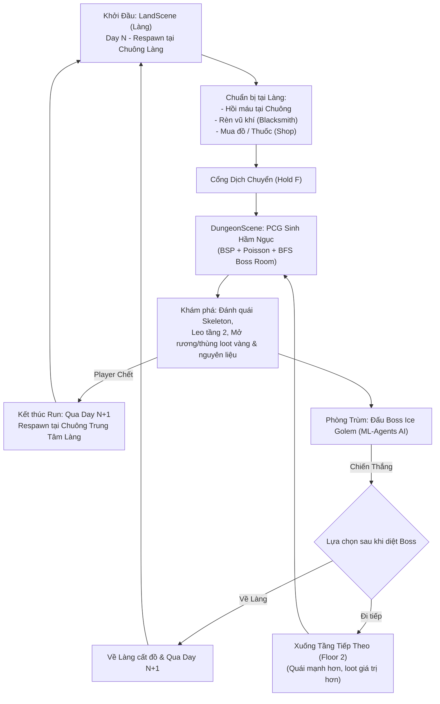
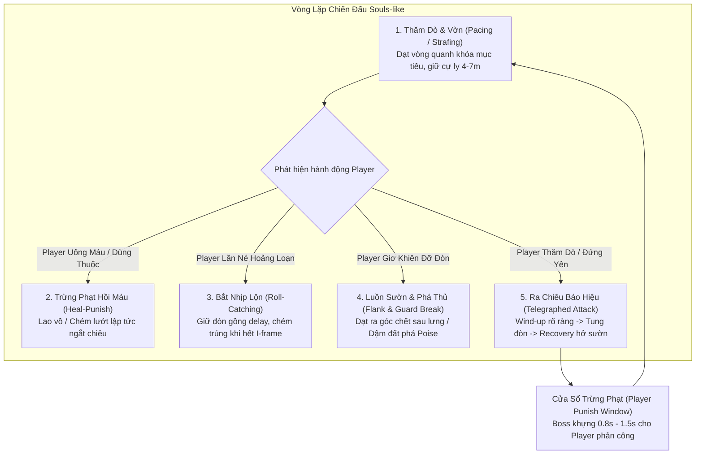

# Kiến Trúc Hệ Thống (System Architecture) - Infinite Labyrinth

> **Dự án:** Infinite Labyrinth (Game 3D Action RPG Roguelite - Đồ Án Tốt Nghiệp)  
> **Phong cách nghệ thuật:** Faceted Low-poly  
> **Engine:** Unity (Universal Render Pipeline - URP)  
> **Ngôn ngữ:** C#  

---

## 1. Vòng Lặp Trò Chơi Cốt Lõi (Core Game Loop & Day System)

---

## 2. Kiến Trúc Các Phân Hệ (System Modules)

### A. Phân Hệ Dungeon PCG (Procedural Content Generation)
Hầm ngục được sinh tự động hoàn toàn mỗi khi người chơi bước qua cổng:
1. **Phân chia không gian (`BSPGenerator.cs`, `BSPNode.cs`):** Thuật toán Binary Space Partitioning chia khối không gian, tạo các phòng và kết nối bằng mạng lưới hành lang.
2. **Phân tích hình học & Tìm phòng Boss (`DungeonRoomAnalyzer.cs`):**
   * Sử dụng thuật toán **BFS / Flood-Fill** từ phòng khởi đầu (`startRoom`) để đo độ dài đường đi ngắn nhất.
   * Phòng xa nhất và có không gian đủ lớn sẽ được chọn làm **Boss Room** (`ceilingHeight = 16f`, vòm trần đồ sộ chuẩn đấu trường).
   * Phân loại các phòng chức năng: Start Room, Boss Room, Mezzanine Room (Phòng gác lửng tầng 2), Treasure Room, Normal Room.
3. **Dựng hình học 3D (`DungeonRenderer.cs`):** 
   * Dựng sàn, tường, cửa mở, và hệ thống cầu thang 3D nối sàn tầng 1 lên gác lửng tầng 2.
   * Áp dụng Perlin Noise để tạo độ gồ ghề và biến thể hoa văn vật liệu cho sàn đá.
4. **Trang trí, Templates & Phân bổ đạo cụ (`DungeonPropDecorator.cs` & Sub-modules):**
   * Được thiết kế theo mô hình **Facade Orchestrator & Partial Modules** sạch sẽ:
     * `DungeonPropDecorator.cs`: Nhạc trưởng điều phối, lưu trữ serialized fields và API entry point `DecorateDungeon(...)`.
     * `DungeonPropDecorator.Templates.cs`: 8 mẫu tường vỡ/chữ L/cổng vòm và 5 mẫu tiểu cảnh (trại, tiệc tàn, giả kim, kho đổ nát). Tự động đo Bounding Box, xoay 4 hướng, đảm bảo an toàn cửa/cầu thang.
     * `DungeonPropDecorator.Lighting.cs`: Đuốc sàn (Floor Torch) nâng offset Y 0.5m chống lún chân đế, đuốc tường và đuốc hành lang kiểm tra tường đặc chống lơ lửng.
     * `DungeonPropDecorator.Mezzanine.cs`: Trang trí gác lửng Tầng 2 khớp chuẩn cao độ 8m (cờ hiệu, khiên kiếm, bàn ghế ngắm cảnh lan can và rải rác sàn).
     * `DungeonPropDecorator.Furniture.cs`: Bố trí nội thất áp vách tường, bàn ghế tâm phòng, góc phòng và rải rác tự do.
     * `DungeonPropDecorator.Spatial.cs`: Thuật toán lưới, tính toán `forbiddenTiles` chống đè đồ, kiểm tra tường đặc và phân bố họ cờ hiệu.
     * `DungeonStaticPropCombiner.cs`: Module gộp toàn bộ đồ tĩnh trong mỗi phòng theo Material thành 1 Draw Call duy nhất, tắt Shadow Casting và lọc bỏ MeshCollider thừa cho cờ vải/thủy tinh.
5. **Tối ưu hóa ánh sáng & Hiệu ứng hạt (`DungeonLightOptimizer.cs`):**
   * **Culling kép (Dual Culling):** Bật/tắt đồng bộ cả `Light` (Point Light) và `ParticleSystem` (Lửa & Khói của đuốc) dựa trên cự ly tới Player. Khi ở xa, hạt bị dừng mô phỏng CPU và xóa quads GPU, loại bỏ hoàn toàn hiện tượng Overdraw xuyên tường.
   * **Hysteresis Buffer:** Độ đệm 6m chống nhấp nháy đèn (Flicker-free) ở ranh giới culling.
   * **Triệt tiêu Shadow Caster Pass:** Tự động phát hiện và vô hiệu hóa shadow pass của Directional Light cường độ 0 (tiết kiệm 4 cascades 2048x2048 vô ích).
   * **Duy trì FPS cực cao:** Đạt 110 - 120 FPS ngay cả trong hầm ngục quy mô lớn 300m x 322m với Far Clip Plane 200m.

---

### B. Phân Hệ Combat Souls-like (Player & Monsters)
* **Giao diện Người chơi Souls-like (`PlayerHUD.cs`):**
  * **Thanh Máu (Health Bar):** MainFill đỏ kèm **Ghost Bar** vàng nhạt tụt đuổi từ từ sau thời gian trễ `ghostShrinkDelay = 0.5s` khi dính đòn.
  * **Thanh Thể lực (Stamina Bar):** Màu cam/vàng, co giãn mượt mà khi Lăn né (Roll), Chạy nhanh (Sprint), Chém kiếm (Attack).
  * **Cụm 3 Ngôi Sao Năng Lượng (Spirit Stars):** Nạp đầy dần khi chém trúng quái hoặc parry chuẩn, tiêu hao khi kích hoạt chiêu E (Sóng kiếm) hoặc Q (Nổ năng lượng).
* **Thanh chịu đòn Poise (`PlayerFeedback.cs`, `EnemyFeedback.cs`):**
  * Cả người chơi và quái vật đều sở hữu thanh Poise ẩn.
  * Khi bị đánh liên tục hoặc dính đòn nặng, Poise tụt về 0 sẽ gây ra trạng thái **Stagger (Khựng đòn / Thất thế)**.
  * Tự động hồi phục sau một khoảng trễ (`poiseRecoveryDelay = 2.5s`).
* **Hệ thống Tài nguyên Player (`PlayerStats.cs`):**
  * **Máu (Health):** Gắn liền với `Health.cs` và interface `IDamageable.cs`.
  * **Thể lực (Stamina):** Max 100. Tiêu hao khi Lướt/Lăn né (Roll: 20), Chạy nhanh (Sprint: 15/s), Chém thường (15), Chém gồng (30), Giơ thế đỡ hụt (20). Tự động hồi phục sau 0.85s trễ.
  * **Năng lượng Chiêu thức (Spirit / Focus):** Max 150. **Không tự hồi**, chỉ tích lũy khi chém trúng quái (+12 thường, +30 gồng, +35 counter, +40 parry chuẩn). Tiêu hao cho kỹ năng:
    * **Phím E:** Sóng kiếm chém xa (`ProjectileSlash.cs`, tốn 50 Spirit).
    * **Phím Q:** Phép nổ năng lượng diện rộng (`AoeSpell.cs`, tốn 100 Spirit).
* **Cơ chế Đỡ đòn & Phản công (Parry & Counter - `PlayerCombat.cs`):**
  * Chuột phải (RMB) kích hoạt thế thủ với cửa sổ vàng `parryWindowDuration = 0.28s`.
  * Parry trúng đòn: Hoàn trả thể lực, nạp mạnh Spirit, làm choáng đối thủ và mở ra đòn Counter sát thương cực lớn.
* **Cơ chế Né đòn & Di chuyển (`PlayerController.cs`):**
  * Phím Shift: Nhấn nhả (< 0.25s) để Lăn né với 0.45s thời gian bất tử (I-frames); Giữ (> 0.25s) để Sprint.
  * Khóa mục tiêu (Target Lock Souls-like): Camera tập trung vào mục tiêu, nhân vật chuyển sang thế vờn/bước ngang (`strafeSpeed`).
  * Nhảy & Rơi (Jump, Fall, Air Control, phân biệt tiếp đất nhẹ và Hard Landing khựng chân khi rơi từ gác lửng).
* **Đạo diễn Lượt đánh Quái (`AttackTokenDirector.cs`):**
  * Áp dụng hệ thống Token Pool. Quái bao vây chỉ giữ cự ly vờn; chỉ quái nào xin được "Attack Token" từ Director mới được lao vào tấn công, chống spam hội đồng.

---

### C. Phân Hệ Quái Vật (Monsters) & Trùm Học Máy (ML-Agents Boss)
* **Bộ Sinh Quái Tự Động Theo Biệt Đội (`ProceduralEnemySpawner.cs`):**
  * **Cơ chế Cụm / Biệt Đội (Squad / Pack System):**
    * Không bó cứng quái theo tầng mà phối hợp linh hoạt Melee & Ranged theo 4 cấp đội hình:
      * Nhóm 4 quái: 2 Melee (1 Warrior + 1 Minion) + 2 Ranged (1 Rogue + 1 Mage).
      * Nhóm 3 quái: 2 Melee + 1 Ranged HOẶC 1 Melee + 2 Ranged.
      * Nhóm 2 quái: 2 Melee HOẶC 1 Melee + 1 Ranged.
      * Nhóm 1 quái lẻ: Random ngẫu nhiên 1 trong 4 loại quái.
  * **Phân bổ theo quy mô phòng (Dungeon 300x300m):**
    * Sàn trệt phòng thường: 1 – 2 nhóm; Sàn trệt đại sảnh lớn (>= 220 tiles): 2 – 3 nhóm.
    * Sàn tầng 2 gác lửng: 1 – 2 nhóm (tỷ lệ 2 nhóm là 25%).
    * Start Room & Boss Room: Miễn nhiễm hoàn toàn (0 quái).
    * Treasure & Shrine Room: 1 nhóm nhỏ (1–2 quái) canh giữ.
  * **Định vị Cụm (Spatial Clustering):** Mỗi nhóm chọn 1 Điểm Neo (Anchor Point), quái tụ tập bán kính 3m quanh tâm, các nhóm cách nhau tối thiểu 8.5m. Nắn chuẩn 100% lên bề mặt NavMesh và dùng `Physics.CheckSphere` chống kẹt vào đạo cụ tĩnh.
* **Bộ Tối Ưu Hóa Ngủ Đông Quái Vật (`DungeonEnemyOptimizer.cs`):**
  * **Cơ chế 3 Vùng LOD & Ngủ Đông (Hibernation):**
    * *Thức tỉnh hoàn toàn (< 40m):* Quái chạy đầy đủ AI, NavMeshAgent di chuyển và Animator xương.
    * *Vùng đệm Hysteresis (40m - 48m):* Độ đệm 8m chống giật hoặc bật/tắt liên tục khi người chơi đứng sát ngưỡng.
    * *Ngủ đông triệt để (> 48m):* Dừng `NavMeshAgent` (ngắt `ObstacleAvoidanceType.NoObstacleAvoidance`), đặt `Animator.cullingMode = CullCompletely`, ngắt lệnh `Update()` AI -> Giảm 0% chi phí CPU/GPU cho ~200 quái vật ở xa.
  * **Time-Slicing Batching (4 Batches, 0.12s):** Danh sách 200 quái được chia đều thành 4 nhóm để luân phiên tính khoảng cách tới người chơi, triệt tiêu hoàn toàn CPU Frame Spike.
  * **Đánh thức Tức thì (Instant Combat Wakeup):** Khi quái đang ngủ bị người chơi tấn công (bắn tên, phóng chưởng từ xa), hàm `OnTakeDamageAggro` lập tức đánh thức quái dậy phản xạ chiến đấu.
* **Quái thường (Bộ xương Skeleton):**
  1. `SkeletonWarriorAI`: Chiến binh cận chiến, biết leo cầu thang lên/xuống tầng 2 để truy sát người chơi.
  2. `SkeletonMinion`: Quái cận chiến số lượng đông, máu yếu nhưng đánh bọc lót.
  3. `SkeletonRogue`: Thích khách cơ động, bắn cung tầm xa (`Skeleton_Arrow.prefab`), biết giữ khoảng cách.
  4. `SkeletonMage`: Pháp sư bắn đạn ma pháp cầu đuổi (`Light Star.prefab`), thi triển vùng đất bốc cháy (`MageGroundSpell.prefab`) và cột sáng trừng phạt (`LightPillarSkill.prefab`).
* **Bộ Đôi Trùm Hầm Ngục & Cặp Đấu Souls-like (Dual Boss Encounters):**
  1. **Trùm Băng: Ice Golem (`Boss_IceGolem.prefab` - The Frost Juggernaut):**
     * **Định vị chiến đấu & Cơ cấu Pha:** **Đơn pha (Single Phase - Không có Phase 2)**. Đỡ đòn hạng nặng, khống chế diện rộng, độ khó và sức mạnh ổn định nhất quán từ đầu đến cuối trận đấu để làm Boss thử thách cự ly và khả năng căn nhịp né đòn đập sàn.
     * **Bộ chiêu thức hoàn chỉnh (7 Kỹ năng chiến đấu trên `IceGolemController.cs`):**
       * `Attack1` *(Phím 1)*: Đấm thẳng cận chiến kết hợp hiệu ứng va đập Impact VFX (`A VFX Prefabs/Explossion/Impact`).
       * `GumoGumo Slam` *(Phím 2)*: Đấm liên hoàn xuống sàn rung đất, phát sinh hiệu ứng `Attack1 Effect` chấn động mặt sàn.
       * `FlameBreath` *(Phím 3)*: Phun lửa hình nón (Flame Cone) tầm trung đa tầng sát thương.
       * `JumpAttack` *(Phím 4)*: Lao bổ / vồ tới mục tiêu từ cự ly xa 20m, phát sinh sóng chấn động tỏa vòng tròn (Radial Shockwave).
       * `RunAttack` *(Phím 5)*: Chạy lao húc thẳng vào Player với vận tốc 12m/s và đẩy văng mạnh mục tiêu; hỗ trợ slot trống `runAuraVfxPrefab` để người dùng tự do kéo thả VFX hào quang xanh quanh thân.
       * `AttackLT_IG` *(Phím 6)*: Chuỗi combo 3 đòn đánh thường liên hoàn cực đẹp; hỗ trợ slot trống `handAuraVfxPrefab` để kéo thả VFX bao quanh 2 bàn tay.
       * `IceBallIG` *(Phím 7)*: Gồng tụ quả cầu ma lực tím `Purple Orb` lơ lửng chính giữa hai bàn tay trên trời (`GetBetweenHandsPosition()`), bám theo tay vươn cao và phình to dần từ 0.4 lên 2.2, sau đó bổ hai tay ném thẳng về phía Player với vận tốc 16m/s và phát nổ diện rộng khi va chạm.
       * `JumpDown` *(Mở màn duy nhất 1 lần khi phát hiện Player / One-Time Intro Cutscene)*: Đáp đất mở màn ấn tượng từ trên cao 12-16m kèm shockwave rền vang lan tỏa từ chân Boss. Tự động kích hoạt khi lần đầu phát hiện Player trong tầm 35m và khóa vĩnh viễn sau cú đáp đất đầu tiên (`hasTriggeredJumpDown = true`), không cho phép dùng đi dùng lại trong trận đấu (đã gỡ bỏ phím Space để tránh spam).
     * **Hệ thống Di chuyển 4 hướng & Chuẩn Hóa Rig Humanoid:**
       * Chuẩn hóa 100% 14 State trong `BossController.controller` sang Humanoid Sub-asset trong file FBX (`internalID: -203655887218126122`), triệt tiêu hoàn toàn lỗi chìm nửa người xuống đất của các file animation Generic cũ.
       * Nhận diện 4 hướng di chuyển: Tiến (`Walk`), Lùi (`WalkBackIG`), Dạt Trái (`WalkLeftIG`), Dạt Phải (`WalkRightIG`) trong khi vẫn khóa mặt bám sát Player (`strafeMode = true`). Điều khiển thủ công qua **4 phím mũi tên (Arrow Keys)** tách biệt độc lập với phím W, A, S, D của Player.
     * **Khóa mục tiêu & Tự động hóa an toàn:**
       * Tự động phát hiện Player (`autoFindPlayer`), tự xoay mặt đối diện đối thủ (`alwaysFacePlayer`, `facePlayerOnAttack`, tốc độ `facePlayerSpeed = 240 deg/s`).
       * Cơ chế tự bảo vệ chống duplicate component trong `Awake()` và Menu dọn dẹp Scene Editor (`Infinite Labyrinth -> Boss -> 3. Dọn Dẹp Scene & Khắc Phục Lỗi Ice Golem`).

  2. **Trùm Lửa: Red Ignis (`Boss_RedIgnis.prefab` - The Crimson Duelist):**
     * **Định vị chiến đấu:** Kiếm sĩ tốc độ cao, phản xạ nhanh, áp sát chớp nhoáng, vờn đối thủ.
     * **Cơ Chế 2 Pha Đột Biến (Two-Phase Boss - Rebirth on Death with New Appearance):**
       * **Phase 1 (The Crimson Duelist):** Thanh kiếm đơn, dáng đứng thanh thoát, di chuyển vờn (strafing) ở cự ly 4-6m, chém nhanh, lướt sườn bọc lót.
       * **Thời Khắc Chuyển Pha (Phase Transition on Death):** Khi thanh máu Phase 1 tụt về 0, Boss **không chết ngay** mà kích hoạt chuỗi Tái Sinh (Resurrection):
         - Quỵ gối rơi vào trạng thái bất tử tạm thời (`invulnerable = true`).
         - Bùng nổ vụ nổ sóng nhiệt (Heat Wave Explosion) đẩy lùi Player ra xa.
         - **LỘT XÁC DIỆN MẠO MỚI (New Appearance Transformation):** Hoán đổi Mesh/Model hoặc kích hoạt hào quang lửa rực cháy (Flaming Wings / Dark Flame Aura), vũ khí bao phủ bởi ngọn lửa cuồng nộ (Blazing Blade), phục hồi 100% thanh máu với danh xưng mới.
       * **Phase 2 (True Flame Ignis - The Awakened):** Tốc độ di chuyển tăng 30%, nhịp vung kiếm dồn dập, mở khóa chiêu thức tối thượng (Sóng lửa chém xa, Lướt chém để lại vệt lửa rực cháy mặt sàn).
     * **Hệ thống Vật lý Áo choàng (`UnityChanSpringBone`):**
       * Quản lý bằng `SpringManager.cs` và `SpringBone.cs` đã được vá mã nguồn triệt tiêu 100% lỗi `NullReferenceException`.
       * Tối ưu hóa chuỗi 12 xương hợp lệ (loại bỏ 4 xương ngọn leaf bones `Bone.013`, `Bone.025`, `Bone.035`, `Bone.037` để triệt tiêu lỗi quẹo 90 độ; dọn sạch 7 ô null trong mảng).
       * Tắt `Enable Angle Limits` và `Collide With Ground` để tà áo buông rủ mềm mại theo trọng lực tự nhiên, tối ưu `stiffnessForce = 50`, `dragForce = 0.4`.
     * **Chuẩn Hóa Khung Xương Humanoid & Animation:**
       * Sửa lỗi gốc tự động map nhầm `Hips -> Armature` trong `RedIgnis.fbx`, trỏ chuẩn xác về `mixamorig:Hips`.
       * Chuẩn hóa hoạt ảnh bước đi `Ignis_Walk.fbx` với `Based Upon = Feet / Center of Mass`, nâng Offset cao độ chống hiện tượng lún đất hoặc co ngắn chiều cao thân thể.
     * **Vũ Khí Kiếm Siu Nhân Đỏ (`KiemSiuNhanDo.fbx`):**
       * Thiết lập Import Settings chuẩn vũ khí tĩnh: `Animation Type: None` (tab Rig), tắt `Import Animation`.
       * Gắn vào tay phải qua điểm neo `RightHand_Socket` trên xương `mixamorig:RightHand`, đồng bộ chuyển động 100% theo mọi cử động bàn tay.

---

### D. Kiến Trúc AI Souls-like & Học Máy Tăng Cường (Boss ML-Agents Architecture)

#### 1. Triết Lý Thiết Kế Hành Vi Trùm Souls-like (Souls-like Combat Dynamics)
Để tạo ra trải nghiệm giác đấu nghẹt thở chuẩn phong cách Souls-like (*Elden Ring, Dark Souls, Sekiro*), AI không được phép là "bot xả chiêu vô tội vạ" mà phải tuân thủ nghiêm ngặt 5 nguyên lý:

1. **Báo Hiệu Đòn Đánh (Tell & Telegraphing):** Mỗi chiêu thức chia làm 3 pha rõ rệt:
   * *Pha Gồng (Wind-up):* Giơ cao tay / ngửa cổ lấy đà rõ ràng, kèm âm thanh và VFX tụ lực để người chơi kịp phán đoán né hoặc Parry.
   * *Pha Tung Đòn (Active/Release):* Chém chớp nhoáng hoặc dậm sàn uy lực, gây sát thương.
   * *Pha Hồi Chiêu Khựng Đòn (Recovery Window):* Sau khi ra đòn, Boss có 0.8s - 1.5s thở/thu thế (Punish Window) để người chơi giỏi có cơ hội lao vào phản kích trừng phạt.
2. **Nhịp Thở & Vờn Đối Thủ (Pacing & Circling/Strafing):** Boss không cắm đầu chạy thẳng. Boss biết **bước dạt ngang (Strafe Left / Right)** vòng quanh người chơi ở cự ly trung bình, quan sát thể lực và thế thủ của người chơi để tạo áp lực tâm lý như một kẻ săn mồi.
3. **Bắt Nhịp Lộn Hoảng Loạn (Roll-Catching):** Khi Player hoảng loạn bấm Lăn né liên tục (Panic Roll), AI học được cách **giữ đòn trễ nhịp (Delayed Attack / Tracking Swing)** để vung đòn trúng ngay khoảnh khắc Player vừa chạm đất hết thời gian bất tử (I-frames).
4. **Trừng Phạt Khi Dùng Bình Máu (Heal-Punish / Input Reading):** Khi phát hiện Player lùi xa uống máu (`isHealing = true`), Boss lập tức kích hoạt chiêu áp sát nhanh (`JumpAttack` của Golem hoặc Lướt kiếm của Ignis) để trừng phạt sơ hở.
5. **Phân Định Cơ Chế Giai Đoạn (Single Phase vs Two-Phase Rebirth):**
   * **Ice Golem (Đơn Pha - Single Phase):** Hoàn toàn **không có Phase 2**. Boss duy trì nhịp độ và phong cách đỡ đòn dậm sàn vững chắc từ đầu đến cuối trận đấu để rèn luyện kỹ năng giữ khoảng cách và phản xạ nhảy/né chấn động của người chơi.
   * **Red Ignis (2 Pha - Tái Sinh Khi Chết & Lột Xác Diện Mạo Mới):** Sở hữu cơ chế 2 Pha kinh điển Souls-like (*Malenia, Sister Friede*). Khi thanh máu Phase 1 về 0, Boss quỵ ngã -> bùng nổ ngọn lửa địa ngục đẩy lùi người chơi -> hồi sinh 100% máu và **lột xác sang diện mạo mới** (New Appearance Model / Flaming VFX / Blazing Sword), kích hoạt bộ não AI Phase 2 với nhịp độ áp sát và combo hủy diệt.

---

#### 2. Thiết Kế Mạng Nơ-ron ML-Agents (Reinforcement Learning with PPO)

* **Không Gian Quan Sát (Observation Vector - 26 floats):**
  | Nhóm dữ liệu | Số chiều | Ý nghĩa chi tiết |
  | :--- | :---: | :--- |
  | **Không gian & Vị trí** | 3 | Vector hướng chuẩn hóa tới Player (`dirToPlayer.x, y, z`) |
  | **Khoảng cách** | 1 | Khoảng cách thực tế chuẩn hóa (`distance / maxArenaRadius`) |
  | **Góc quay đối diện** | 2 | Tích vô hướng hướng nhìn (`Dot forward` & `Dot right` tới Player) |
  | **Sinh mệnh Boss** | 1 | Tỷ lệ máu hiện tại của Boss (`bossHealth / bossMaxHealth`) |
  | **Sinh mệnh Player** | 1 | Tỷ lệ máu hiện tại của Player (`playerHealth / playerMaxHealth`) |
  | **Thể lực Player** | 1 | Tỷ lệ Stamina của Player (`playerStamina / 100f`) |
  | **Trạng thái Player** | 4 | `isAttacking`, `isRolling` (I-frame), `isParrying`, `isHealing` (0 hoặc 1) |
  | **Thời gian hồi chiêu** | 4 | Tỷ lệ sẵn sàng của 4 kỹ năng (`cooldownRemaining / maxCooldown`) |
  | **Giai đoạn trận đấu** | 1 | Phase 1 (0) hay Phase 2 Cuồng nộ (1) |
  | **Cảm biến địa hình** | 8 | Raycast Sensor 8 hướng phát hiện khoảng cách tới tường đấu trường |

* **Không Gian Hành Động (Action Space - Discrete Branches):**
  * **Branch 0 - Di chuyển & Vờn đối thủ (5 lựa chọn):**
    * `0`: Đứng thủ thế / Thăm dò (Idle)
    * `1`: Tiến thẳng áp sát (Move Forward)
    * `2`: Lùi lại giữ cự ly an toàn (Move Backward)
    * `3`: Dạt trái vòng quanh Player (Strafe Left)
    * `4`: Dạt phải vòng quanh Player (Strafe Right)
  * **Branch 1 - Quyết định Ra đòn (5 lựa chọn):**
    * `0`: Không đánh (Chờ thời cơ hoặc giữ nhịp thở)
    * `1`: Đòn đánh thường cận chiến (Attack 1)
    * `2`: Đòn liên hoàn / Đấm sàn rung đất (GumoGumo Slam / Combo Slash)
    * `3`: Đòn nhảy vồ / Lướt áp sát tầm xa (Jump Attack / Dash Thrust)
    * `4`: Đòn đặc biệt / Phun lửa diện rộng (Flame Breath / Flaming Whirlwind)
  * **Branch 2 - Tùy biến Nhịp đòn (3 lựa chọn):**
    * `0`: Đánh tốc độ chuẩn (Normal timing)
    * `1`: Đánh gồng trễ nhịp (Delayed Attack / Roll-catcher)
    * `2`: Nhử đòn / Hủy đòn thăm dò (Feint)

* **Thiết Lập Hàm Thưởng / Phạt (Reward Function):**
  | Hành vi | Điểm thưởng/phạt | Mục đích huấn luyện |
  | :--- | :---: | :--- |
  | **Đánh trúng Player (khi không bị né/parry)** | `+1.0 * (damage / 20f)` | Khuyến khích tấn công chính xác |
  | **Trừng phạt thành công khi Player uống máu** | `+2.0` | Tạo phản xạ Heal-Punish kinh điển Souls-like |
  | **Bắt trúng đòn khi Player vừa hết Roll I-frame** | `+1.5` | Huấn luyện kỹ năng Roll-Catching |
  | **Hạ gục Player (Player HP = 0)** | `+5.0` ➔ `EndEpisode()` | Mục tiêu tối thượng của trận đấu |
  | **Duy trì khoảng cách combat lý tưởng (3m - 6m)** | `+0.001` per step | Khuyến khích vờn quanh, không chạy ra góc lag |
  | **Tung chiêu trượt vào không khí** | `-0.3` | Tránh spam chiêu vô tội vạ |
  | **Tung chiêu khi Player đang trong I-frame né đòn** | `-0.5` | Dạy AI không đánh vào lúc đối thủ bất tử |
  | **Bị Player Parry thành công (Bị choáng)** | `-1.5` | Dạy AI biết sợ thế thủ và không ra đòn dễ đoán |
  | **Bị Player chém trúng** | `-0.4 * (damage / 20f)` | Dạy AI biết né tránh, dạt sườn giữ khoảng cách |
  | **Boss tử trận (Boss HP = 0)** | `-5.0` ➔ `EndEpisode()` | Trừng phạt thất bại |
  | **Phạt thời gian tồn tại (`Existence Penalty`)** | `-0.0005` per step | Ép Boss chủ động kết liễu trận, chống cù nhây |

* **Quy Trình Đào Tạo Đa Sàn Đấu (Multi-Arena Parallel Training):**
  * Trong Scene huấn luyện, nhân bản **8 hoặc 16 sàn đấu Arena** chạy song song.
  * Huấn luyện thông qua `mlagents-learn` với thuật toán PPO trên môi trường Python ảo (`venv`), xuất ra file **`.onnx`** (ví dụ `IceGolem_SoulsAI.onnx` và `RedIgnis_SoulsAI.onnx`).
  * Nạp file `.onnx` vào component `Behavior Parameters` (chế độ `Inference Only`) để chạy mượt mà 100% thời gian thực trong game cuối cùng mà người chơi không cần cài Python hay PyTorch.

---

### D. Phân Hệ Tiến Trình RPG (RPG Progression & Economy)
1. **Hệ Thống Rơi Đồ Thế Giới (Loot Drop & World Drops):**
   * **Nguồn rơi đồ:** Quái vật chết (`Health.onDeath`), Thùng gỗ/hòm đập vỡ (`BreakableProp.cs` nhận đòn qua `IDamageable`), Rương kho báu mở (`ChestInteractable.cs`).
   * **Hiệu ứng vật lý văng đồ (Arc Pop Physics):** Vật phẩm búng nảy theo hình vòng cung parabol nhẹ khi xuất hiện (`LootDropper.cs`), tránh đè dính chùm.
   * **Vật phẩm thế giới (`WorldItemPickup.cs`):** Model 3D thu nhỏ, xoay lơ lửng, tia sáng hào quang nhẹ (Loot Beam/Glow) tương ứng theo độ hiếm.
   * **Tương tác nhặt đồ:** Player lại gần trong bán kính 2m hiển thị Pickup Prompt UI (Icon + Tên + Phím `[F]`). Tiền Vàng hỗ trợ cơ chế tự động bay hút (Magnetic Auto-pickup) khi lại gần.
   * **Thông báo nhặt đồ (`PickupNotificationFeed.cs`):** Xếp chồng mép trái màn hình, trượt mượt lên từ dưới (smooth slide up), mờ dần sau 2.5s.
2. **Hệ Thống Túi Đồ 2 Cửa Sổ (Dual-Pane Inventory Screen - Phím Tab):**
   * **Kiến trúc điều phối chính (`InventoryUIController.cs`):** Quản lý đóng/mở mượt mà bằng CanvasGroup (phím `Tab` hoặc `Esc`), tự động giải phóng con trỏ chuột (`Cursor.lockState = None`), khóa di chuyển người chơi và đóng băng xoay camera / combat. Tự động kiểm tra và khởi tạo `EventSystem` + `InputSystemUIInputModule` tại runtime nếu scene bị thiếu.
   * **Cửa sổ Trái (Character & Stats):**
     * **3D Character Preview (`CharacterPreviewController.cs`):** Camera phụ chuyên dụng soi nhân vật qua `RenderTexture` (512x512). Thiết lập `cullingMask = 1 << 3` (chỉ soi Layer 3: Player) giúp loại bỏ 100% tường, sàn, quái hầm ngục khỏi khung xem trước; kèm đèn định hướng mềm. Hỗ trợ sự kiện chuột `IDragHandler` cho phép nhấp giữ chuột trái và kéo ngang trên khung để xoay nhân vật 360 độ. Tự động tắt Camera khi đóng túi để tiết kiệm 100% tài nguyên GPU trong lúc chơi game.
     * **Ô trang bị (`EquipmentSlotUI.cs`):** Quản lý 2 ô chuyên dụng: Ô Vũ khí (`WeaponSlot`) & Ô Giáp (`ArmorSlot`). Tự động ẩn placeholder khi đã mặc đồ, đổi icon và tô màu nền trắng `RarityBG` theo phẩm cấp món đồ. Click vào mở popup chi tiết với nút `[Tháo ra]`.
     * **Bảng chỉ số thời gian thực (`PlayerStatsPanelUI.cs`):** Tự động liên kết và đọc chỉ số từ `PlayerCombat.cs`, `Health.cs`, `PlayerStats.cs` và `InventoryManager.cs`. Hiển thị: Sát thương tấn công (ATK + Bonus), Phòng thủ (DEF), Máu tối đa (Max HP + Bonus), Thể lực tối đa (Stamina + Bonus). Cập nhật tức thì ngay khi đổi trang bị.
     * **Nút Cộng Điểm Tiềm Năng (`BtnAttributePoints`):** Mở Modal phân bổ thuộc tính (sẵn sàng kết nối Task RPG-05).
   * **Cửa sổ Phải (Kho Đồ & Thao Tác):**
     * **Thanh Tab phân loại 4 danh mục:** `BtnAll` (Tất cả), `BtnWeapon` (Vũ khí), `BtnArmor` (Giáp), `BtnItem` (Vật phẩm tiêu hao & nguyên liệu). Tự động lọc lưới và điều khiển viền góc `SelectHighlight` tương ứng, giữ nguyên độc lập bảng màu `Color Tint` trên Button của Unity.
     * **Lưới 30 ô túi đồ (`InventorySlotUI.cs`):** GridLayoutGroup 5x6. Hiển thị Icon (tự động ẩn an toàn nếu chưa có sprite), nền trắng `RarityBG` đổi màu theo phẩm cấp Rarity, số lượng dồn stack (`xCount`), viền trang trí góc `SelectHighlight` khi được chọn.
     * **Hiển thị Tiền Vàng:** Cập nhật số dư vàng thời gian thực qua event `OnGoldChanged`.
     * **Bảng Chi Tiết Vật Phẩm Động (`ItemDetailPopupUI.cs`):**
       * Tự động tính toán toạ độ và bám theo ô đồ vừa click (`PositionNearSlot`): Mặc định đặt góc trên-trái của Popup nằm đúng tâm ô đồ; nếu ô ở hàng dưới cùng thì tự động đảo pivot thành góc dưới-trái để trồi lên trên; nếu ô ở sát mép phải thì tự động mở sang trái, đảm bảo 100% không tràn khỏi màn hình. Click lại chính ô đó sẽ tự động đóng Popup.
       * Tách riêng Text độ hiếm `ItemRarity` (tô màu theo phẩm cấp) và phân loại `ItemType`.
       * Cụm 4 nút hành động: `BtnEquip` và `BtnUnequip` xếp đè cùng 1 vị trí (Trang bị hiện khi xem đồ trong túi, Tháo ra hiện khi xem đồ đang mặc); `BtnUse` cho vật phẩm tiêu hao (bình máu); `BtnDrop` vứt đồ rơi ra sàn thế giới.
3. **Kinh Nghiệm, Cấp Độ & Điểm Tiềm Năng (`PlayerProgression.cs`, `AttributeAllocationUI.cs`):**
   * **EXP & Cấp độ:** Tiêu diệt quái vật (`EnemyAIBase.cs`) nhận EXP. Cập nhật thanh EXP dạng vòng tròn chữ C (`ExpRingFill`) trên `PlayerHUD.cs` với ánh xạ fill từ `0.19` đến `0.58`. Hiển thị Cấp độ trên huy hiệu `LevelText`.
   * **Điểm tiềm năng (Attribute Points):** Lên cấp thưởng điểm (mặc định 3 điểm / cấp). Mở modal phân bổ từ nút `BtnAttributePoints` ở cửa sổ trái Inventory (hiển thị badge `+X` điểm khả dụng).
   * **Phân bổ 3 chỉ số:** Sức Tấn Công (ATK), Máu Tối Đa (Max HP), Thể Lực Tối Đa (Max Stamina) với chế độ xem trước thay đổi chỉ số thời gian thực (`Current -> Preview (+Bonus)`).
   * **Đồng bộ Combat & Sinh tồn:** Bấm "Xác Nhận" áp dụng trực tiếp vào `Health.cs` (`BaseMaxHealth` + `SetBonusMaxHealth`), `PlayerStats.cs` (`BaseMaxStamina` + `SetBonusMaxStamina`) và `PlayerCombat.cs` (`TotalAttackBonus` cho toàn bộ các đòn đánh).
   * **Tẩy Điểm Tiềm Năng (Reset Stats):** Nút Reset tiêu tốn X Vàng (tùy biến Inspector, mặc định 100 Vàng) qua `InventoryManager.cs`. Hoàn lại 100% điểm tiềm năng và xóa bỏ toàn bộ bonus đã cộng. Kiểm tra chặt chẽ số dư Vàng và khóa nút nếu không đủ.
4. **Hub Ngôi Làng & Thợ Rèn (`LandScene`):**
   * **Chuông Làng Trung Tâm (Village Bell):** Điểm linh hồn hồi phục 100% máu, điểm Respawn sau khi tử trận.
   * **Thợ rèn (Blacksmith):** Tiêu tốn nguyên liệu (Đá cường hóa kiếm) và Vàng để nâng cấp vũ khí (+1, +2...), tăng sát thương chém và hiệu ứng visual.
   * **Cổng dịch chuyển (`PortalController.cs`):** Giữ phím F để bước vào Dungeon.

---

## 3. Quản Lý Trạng Thái Toàn Cục (Game Architecture Patterns)
- **Persist Data:** Sử dụng `GameManager` (DontDestroyOnLoad) hoặc ScriptableObjects để lưu trữ trạng thái giữa các lần chuyển Scene:
  * `CurrentDay`: Số ngày hiện tại (Day 1, Day 2...).
  * `CurrentFloor`: Tầng hầm ngục hiện tại (Floor 1, Floor 2...).
  * `PlayerSaveData`: Lượng Vàng, EXP, Level, Chỉ số nâng cấp, Kho đồ Inventory.
- **Scene Routing:**
  * `LandScene` -> `DungeonScene` (qua Portal).
  * `DungeonScene` (thắng Boss) -> UI popup chọn: Về Làng (`LandScene`) hoặc Đi tiếp (`DungeonScene` tầng kế).
  * `DungeonScene` (thua cuộc) -> Tự động chuyển về `LandScene` tại vị trí Chuông Làng.
