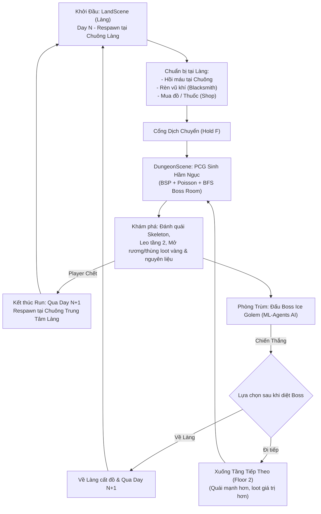

# Kiến Trúc Hệ Thống (System Architecture) - Infinite Labyrinth

> **Dự án:** Infinite Labyrinth (Game 3D Action RPG Roguelite - Đồ Án Tốt Nghiệp)  
> **Phong cách nghệ thuật:** Faceted Low-poly  
> **Engine:** Unity (Universal Render Pipeline - URP)  
> **Ngôn ngữ:** C#  

---

## 1. Vòng Lặp Trò Chơi Cốt Lõi (Core Game Loop & Day System)

---

## 2. Kiến Trúc Các Phân Hệ (System Modules)

### A. Phân Hệ Dungeon PCG (Procedural Content Generation)
Hầm ngục được sinh tự động hoàn toàn mỗi khi người chơi bước qua cổng:
1. **Phân chia không gian (`BSPGenerator.cs`, `BSPNode.cs`):** Thuật toán Binary Space Partitioning chia khối không gian, tạo các phòng và kết nối bằng mạng lưới hành lang.
2. **Phân tích hình học & Tìm phòng Boss (`DungeonRoomAnalyzer.cs`):**
   * Sử dụng thuật toán **BFS / Flood-Fill** từ phòng khởi đầu (`startRoom`) để đo độ dài đường đi ngắn nhất.
   * Phòng xa nhất và có không gian đủ lớn sẽ được chọn làm **Boss Room** (`ceilingHeight = 16f`, vòm trần đồ sộ chuẩn đấu trường).
   * Phân loại các phòng chức năng: Start Room, Boss Room, Mezzanine Room (Phòng gác lửng tầng 2), Treasure Room, Normal Room.
3. **Dựng hình học 3D (`DungeonRenderer.cs`):** 
   * Dựng sàn, tường, cửa mở, và hệ thống cầu thang 3D nối sàn tầng 1 lên gác lửng tầng 2.
   * Áp dụng Perlin Noise để tạo độ gồ ghề và biến thể hoa văn vật liệu cho sàn đá.
4. **Trang trí, Templates & Phân bổ đạo cụ (`DungeonPropDecorator.cs` & Sub-modules):**
   * Được thiết kế theo mô hình **Facade Orchestrator & Partial Modules** sạch sẽ:
     * `DungeonPropDecorator.cs`: Nhạc trưởng điều phối, lưu trữ serialized fields và API entry point `DecorateDungeon(...)`.
     * `DungeonPropDecorator.Templates.cs`: 8 mẫu tường vỡ/chữ L/cổng vòm và 5 mẫu tiểu cảnh (trại, tiệc tàn, giả kim, kho đổ nát). Tự động đo Bounding Box, xoay 4 hướng, đảm bảo an toàn cửa/cầu thang.
     * `DungeonPropDecorator.Lighting.cs`: Đuốc sàn (Floor Torch) nâng offset Y 0.5m chống lún chân đế, đuốc tường và đuốc hành lang kiểm tra tường đặc chống lơ lửng.
     * `DungeonPropDecorator.Mezzanine.cs`: Trang trí gác lửng Tầng 2 khớp chuẩn cao độ 8m (cờ hiệu, khiên kiếm, bàn ghế ngắm cảnh lan can và rải rác sàn).
     * `DungeonPropDecorator.Furniture.cs`: Bố trí nội thất áp vách tường, bàn ghế tâm phòng, góc phòng và rải rác tự do.
     * `DungeonPropDecorator.Spatial.cs`: Thuật toán lưới, tính toán `forbiddenTiles` chống đè đồ, kiểm tra tường đặc và phân bố họ cờ hiệu.
     * `DungeonStaticPropCombiner.cs`: Module gộp toàn bộ đồ tĩnh trong mỗi phòng theo Material thành 1 Draw Call duy nhất, tắt Shadow Casting và lọc bỏ MeshCollider thừa cho cờ vải/thủy tinh.
5. **Tối ưu hóa ánh sáng & Hiệu ứng hạt (`DungeonLightOptimizer.cs`):**
   * **Culling kép (Dual Culling):** Bật/tắt đồng bộ cả `Light` (Point Light) và `ParticleSystem` (Lửa & Khói của đuốc) dựa trên cự ly tới Player. Khi ở xa, hạt bị dừng mô phỏng CPU và xóa quads GPU, loại bỏ hoàn toàn hiện tượng Overdraw xuyên tường.
   * **Hysteresis Buffer:** Độ đệm 6m chống nhấp nháy đèn (Flicker-free) ở ranh giới culling.
   * **Triệt tiêu Shadow Caster Pass:** Tự động phát hiện và vô hiệu hóa shadow pass của Directional Light cường độ 0 (tiết kiệm 4 cascades 2048x2048 vô ích).
   * **Duy trì FPS cực cao:** Đạt 110 - 120 FPS ngay cả trong hầm ngục quy mô lớn 300m x 322m với Far Clip Plane 200m.

---

### B. Phân Hệ Combat Souls-like (Player & Monsters)
* **Giao diện Người chơi Souls-like (`PlayerHUD.cs`):**
  * **Thanh Máu (Health Bar):** MainFill đỏ kèm **Ghost Bar** vàng nhạt tụt đuổi từ từ sau thời gian trễ `ghostShrinkDelay = 0.5s` khi dính đòn.
  * **Thanh Thể lực (Stamina Bar):** Màu cam/vàng, co giãn mượt mà khi Lăn né (Roll), Chạy nhanh (Sprint), Chém kiếm (Attack).
  * **Cụm 3 Ngôi Sao Năng Lượng (Spirit Stars):** Nạp đầy dần khi chém trúng quái hoặc parry chuẩn, tiêu hao khi kích hoạt chiêu E (Sóng kiếm) hoặc Q (Nổ năng lượng).
* **Thanh chịu đòn Poise (`PlayerFeedback.cs`, `EnemyFeedback.cs`):**
  * Cả người chơi và quái vật đều sở hữu thanh Poise ẩn.
  * Khi bị đánh liên tục hoặc dính đòn nặng, Poise tụt về 0 sẽ gây ra trạng thái **Stagger (Khựng đòn / Thất thế)**.
  * Tự động hồi phục sau một khoảng trễ (`poiseRecoveryDelay = 2.5s`).
* **Hệ thống Tài nguyên Player (`PlayerStats.cs`):**
  * **Máu (Health):** Gắn liền với `Health.cs` và interface `IDamageable.cs`.
  * **Thể lực (Stamina):** Max 100. Tiêu hao khi Lướt/Lăn né (Roll: 20), Chạy nhanh (Sprint: 15/s), Chém thường (15), Chém gồng (30), Giơ thế đỡ hụt (20). Tự động hồi phục sau 0.85s trễ.
  * **Năng lượng Chiêu thức (Spirit / Focus):** Max 150. **Không tự hồi**, chỉ tích lũy khi chém trúng quái (+12 thường, +30 gồng, +35 counter, +40 parry chuẩn). Tiêu hao cho kỹ năng:
    * **Phím E:** Sóng kiếm chém xa (`ProjectileSlash.cs`, tốn 50 Spirit).
    * **Phím Q:** Phép nổ năng lượng diện rộng (`AoeSpell.cs`, tốn 100 Spirit).
* **Cơ chế Đỡ đòn & Phản công (Parry & Counter - `PlayerCombat.cs`):**
  * Chuột phải (RMB) kích hoạt thế thủ với cửa sổ vàng `parryWindowDuration = 0.28s`.
  * Parry trúng đòn: Hoàn trả thể lực, nạp mạnh Spirit, làm choáng đối thủ và mở ra đòn Counter sát thương cực lớn.
* **Cơ chế Né đòn & Di chuyển (`PlayerController.cs`):**
  * Phím Shift: Nhấn nhả (< 0.25s) để Lăn né với 0.45s thời gian bất tử (I-frames); Giữ (> 0.25s) để Sprint.
  * Khóa mục tiêu (Target Lock Souls-like): Camera tập trung vào mục tiêu, nhân vật chuyển sang thế vờn/bước ngang (`strafeSpeed`).
  * Nhảy & Rơi (Jump, Fall, Air Control, phân biệt tiếp đất nhẹ và Hard Landing khựng chân khi rơi từ gác lửng).
* **Đạo diễn Lượt đánh Quái (`AttackTokenDirector.cs`):**
  * Áp dụng hệ thống Token Pool. Quái bao vây chỉ giữ cự ly vờn; chỉ quái nào xin được "Attack Token" từ Director mới được lao vào tấn công, chống spam hội đồng.

---

### C. Phân Hệ Quái Vật (Monsters) & Trùm Học Máy (ML-Agents Boss)
* **Bộ Sinh Quái Tự Động Theo Biệt Đội (`ProceduralEnemySpawner.cs`):**
  * **Cơ chế Cụm / Biệt Đội (Squad / Pack System):**
    * Không bó cứng quái theo tầng mà phối hợp linh hoạt Melee & Ranged theo 4 cấp đội hình:
      * Nhóm 4 quái: 2 Melee (1 Warrior + 1 Minion) + 2 Ranged (1 Rogue + 1 Mage).
      * Nhóm 3 quái: 2 Melee + 1 Ranged HOẶC 1 Melee + 2 Ranged.
      * Nhóm 2 quái: 2 Melee HOẶC 1 Melee + 1 Ranged.
      * Nhóm 1 quái lẻ: Random ngẫu nhiên 1 trong 4 loại quái.
  * **Phân bổ theo quy mô phòng (Dungeon 300x300m):**
    * Sàn trệt phòng thường: 1 – 2 nhóm; Sàn trệt đại sảnh lớn (>= 220 tiles): 2 – 3 nhóm.
    * Sàn tầng 2 gác lửng: 1 – 2 nhóm (tỷ lệ 2 nhóm là 25%).
    * Start Room & Boss Room: Miễn nhiễm hoàn toàn (0 quái).
    * Treasure & Shrine Room: 1 nhóm nhỏ (1–2 quái) canh giữ.
  * **Định vị Cụm (Spatial Clustering):** Mỗi nhóm chọn 1 Điểm Neo (Anchor Point), quái tụ tập bán kính 3m quanh tâm, các nhóm cách nhau tối thiểu 8.5m. Nắn chuẩn 100% lên bề mặt NavMesh và dùng `Physics.CheckSphere` chống kẹt vào đạo cụ tĩnh.
* **Bộ Tối Ưu Hóa Ngủ Đông Quái Vật (`DungeonEnemyOptimizer.cs`):**
  * **Cơ chế 3 Vùng LOD & Ngủ Đông (Hibernation):**
    * *Thức tỉnh hoàn toàn (< 40m):* Quái chạy đầy đủ AI, NavMeshAgent di chuyển và Animator xương.
    * *Vùng đệm Hysteresis (40m - 48m):* Độ đệm 8m chống giật hoặc bật/tắt liên tục khi người chơi đứng sát ngưỡng.
    * *Ngủ đông triệt để (> 48m):* Dừng `NavMeshAgent` (ngắt `ObstacleAvoidanceType.NoObstacleAvoidance`), đặt `Animator.cullingMode = CullCompletely`, ngắt lệnh `Update()` AI -> Giảm 0% chi phí CPU/GPU cho ~200 quái vật ở xa.
  * **Time-Slicing Batching (4 Batches, 0.12s):** Danh sách 200 quái được chia đều thành 4 nhóm để luân phiên tính khoảng cách tới người chơi, triệt tiêu hoàn toàn CPU Frame Spike.
  * **Đánh thức Tức thì (Instant Combat Wakeup):** Khi quái đang ngủ bị người chơi tấn công (bắn tên, phóng chưởng từ xa), hàm `OnTakeDamageAggro` lập tức đánh thức quái dậy phản xạ chiến đấu.
* **Quái thường (Bộ xương Skeleton):**
  1. `SkeletonWarriorAI`: Chiến binh cận chiến, biết leo cầu thang lên/xuống tầng 2 để truy sát người chơi.
  2. `SkeletonMinion`: Quái cận chiến số lượng đông, máu yếu nhưng đánh bọc lót.
  3. `SkeletonRogue`: Thích khách cơ động, bắn cung tầm xa (`Skeleton_Arrow.prefab`), biết giữ khoảng cách.
  4. `SkeletonMage`: Pháp sư bắn đạn ma pháp cầu đuổi (`Light Star.prefab`), thi triển vùng đất bốc cháy (`MageGroundSpell.prefab`) và cột sáng trừng phạt (`LightPillarSkill.prefab`).
* **Trùm Hầm Ngục: Ice Golem (`Boss_IceGolem.prefab`):**
  * Bộ animation hoàn chỉnh: `GolemAttack`, `GolemJumpAttack`, `GolemRoaring`, `GolemWalking`, `GolemDead`.
  * **Định hướng Học máy (Unity ML-Agents):**
    * Tích hợp Agent Reinforcement Learning (PPO).
    * **Observation:** Khoảng cách tới Player, hướng nhìn, trạng thái Player (đang chém, đang roll, đang parry, lượng máu/stamina).
    * **Action:** Chọn combo đòn (Vung tay, Dậm đất diện rộng JumpAttack, Gầm tăng nộ Roar, Tiếp cận).
    * **Reward Function:** Thưởng khi đánh trúng người chơi, phạt khi đánh hụt hoặc bị Parry, thưởng khi dồn ép người chơi vào góc tường.

---

### D. Phân Hệ Tiến Trình RPG (RPG Progression & Economy)
1. **Hệ Thống Rơi Đồ Thế Giới (Loot Drop & World Drops):**
   * **Nguồn rơi đồ:** Quái vật chết (`Health.onDeath`), Thùng gỗ/hòm đập vỡ (`BreakableProp.cs` nhận đòn qua `IDamageable`), Rương kho báu mở (`ChestInteractable.cs`).
   * **Hiệu ứng vật lý văng đồ (Arc Pop Physics):** Vật phẩm búng nảy theo hình vòng cung parabol nhẹ khi xuất hiện (`LootDropper.cs`), tránh đè dính chùm.
   * **Vật phẩm thế giới (`WorldItemPickup.cs`):** Model 3D thu nhỏ, xoay lơ lửng, tia sáng hào quang nhẹ (Loot Beam/Glow) tương ứng theo độ hiếm.
   * **Tương tác nhặt đồ:** Player lại gần trong bán kính 2m hiển thị Pickup Prompt UI (Icon + Tên + Phím `[F]`). Tiền Vàng hỗ trợ cơ chế tự động bay hút (Magnetic Auto-pickup) khi lại gần.
   * **Thông báo nhặt đồ (`PickupNotificationFeed.cs`):** Xếp chồng mép trái màn hình, trượt mượt lên từ dưới (smooth slide up), mờ dần sau 2.5s.
2. **Hệ Thống Túi Đồ 2 Cửa Sổ (Dual-Pane Inventory Screen - Phím Tab/I):**
   * **Cửa sổ Trái (Character & Stats):**
     * Khung trung tâm: Model 3D nhân vật thời gian thực qua Camera Sub-Preview + `RenderTexture` (xoay ngắm 360 độ).
     * Ô trang bị: Vũ khí & Giáp hiển thị trang bị đang mặc.
     * Bảng chỉ số người chơi: Sức tấn công (ATK), Máu (HP), Thể lực (Stamina), Phòng thủ (DEF).
     * Nút góc dưới phải: Mở Modal **Cộng Điểm Tiềm Năng** (có badge thông báo khi có điểm dư).
   * **Cửa sổ Phải (Kho Đồ & Thao Tác):**
     * Tab phân loại: `Tất cả` | `Vũ khí` | `Giáp` | `Vật phẩm (Thuốc & Nguyên liệu)`.
     * Lưới ô chứa đồ (Inventory Grid Slots): Icon, viền độ hiếm, số lượng stack (`xCount`).
     * Thanh hiển thị số Vàng hiện có.
     * Cửa sổ thông tin chi tiết: Tên, icon lớn, mô tả lore, stats cộng thêm + 2 nút tương tác **[Trang bị / Sử dụng]** và **[Bỏ]**.
3. **Kinh Nghiệm, Cấp Độ & Điểm Tiềm Năng (`PlayerProgression.cs`):**
   * Tiêu diệt quái nhận EXP -> Cập nhật thanh EXP. Đủ EXP -> Lên cấp.
   * Thưởng Điểm tiềm năng (Attribute Points) để cộng vào: Máu tối đa (Max HP), Sức tấn công (ATK), Thể lực tối đa (Max Stamina).
   * Có chế độ xem trước thay đổi chỉ số trước khi bấm "Xác Nhận".
4. **Hub Ngôi Làng & Thợ Rèn (`LandScene`):**
   * **Chuông Làng Trung Tâm (Village Bell):** Điểm linh hồn hồi phục 100% máu, điểm Respawn sau khi tử trận.
   * **Thợ rèn (Blacksmith):** Tiêu tốn nguyên liệu (Đá cường hóa kiếm) và Vàng để nâng cấp vũ khí (+1, +2...), tăng sát thương chém và hiệu ứng visual.
   * **Cổng dịch chuyển (`PortalController.cs`):** Giữ phím F để bước vào Dungeon.

---

## 3. Quản Lý Trạng Thái Toàn Cục (Game Architecture Patterns)
- **Persist Data:** Sử dụng `GameManager` (DontDestroyOnLoad) hoặc ScriptableObjects để lưu trữ trạng thái giữa các lần chuyển Scene:
  * `CurrentDay`: Số ngày hiện tại (Day 1, Day 2...).
  * `CurrentFloor`: Tầng hầm ngục hiện tại (Floor 1, Floor 2...).
  * `PlayerSaveData`: Lượng Vàng, EXP, Level, Chỉ số nâng cấp, Kho đồ Inventory.
- **Scene Routing:**
  * `LandScene` -> `DungeonScene` (qua Portal).
  * `DungeonScene` (thắng Boss) -> UI popup chọn: Về Làng (`LandScene`) hoặc Đi tiếp (`DungeonScene` tầng kế).
  * `DungeonScene` (thua cuộc) -> Tự động chuyển về `LandScene` tại vị trí Chuông Làng.
